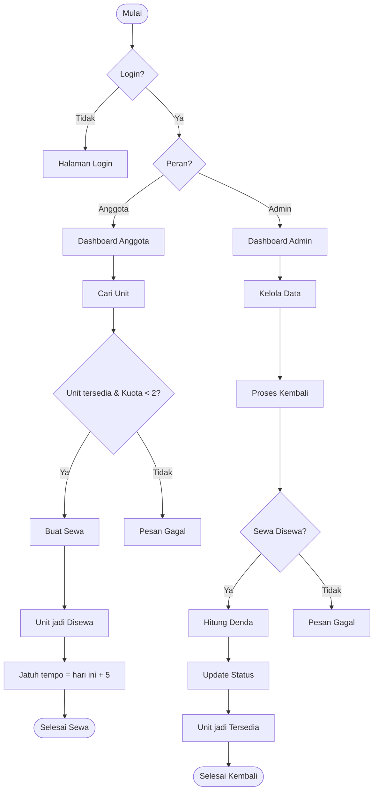

# BRD — XenoRent: Sistem Rental Kapal Alien

Oct 22, 2026 · @Muhammad Fazly Radithya

## Kontrol Dokumen

### Persetujuan

| Versi | Tanggal | Penulis | Ringkasan perubahan |
|-------|---------|---------|---------------------|
| 1.2 | 22 Oktober 2026 | Tim Dokumentasi | Perapian format untuk pengumpulan |
| 1.1 | 22 Oktober 2026 | Tim Dokumentasi | Tambah kontrol dokumen, biaya & manfaat, kebutuhan non-fungsional, dan glosarium |
| 1.0 | 22 Oktober 2026 | Tim Dokumentasi | Draf awal |

| Nama | Peran | Keputusan | Tanggal |
|------|-------|-----------|---------|
| (isi nama) | Penanggung jawab Dokumentasi | Menunggu | |
| (isi nama) | Penanggung jawab Backend | Menunggu | |
| (isi nama) | Penanggung jawab Frontend | Menunggu | |

## 1. Ringkasan Eksekutif

XenoRent adalah aplikasi web untuk menyewa kapal alien. Anggota bisa mendaftar, mencari kapal berdasarkan nama, lalu menyewa maksimal 2 unit selama paling lama 5 hari. Pengembalian hanya bisa diproses oleh Admin, dan keterlambatan dikenakan denda otomatis. Nama produk "XenoRent" masih dapat diganti sesuai kesepakatan tim.

## 2. Latar Belakang & Masalah Bisnis

XenoRent dikelola sebuah hanggar fiktif yang menyimpan armada kapal alien hasil pertukaran antarplanet dan menyewakannya ke anggota terdaftar. Konteks ini fiksi, tetapi aturan bisnisnya mengikuti requirement tugas secara penuh. Cerita latar dipakai untuk konten seed, slide, dan video demo; logika aplikasi tetap sistem sewa unit biasa.

Saat ini pencatatan sewa (dalam cerita) dilakukan manual, sehingga muncul empat masalah:

- Kepemilikan unit tidak jelas. Banyak kapal bernama sama, misalnya tiga unit "Zeta Saucer", sehingga sulit dilacak tanpa kode unik.
- Kuota dan durasi tidak terkontrol. Satu orang bisa menahan terlalu banyak kapal atau terlalu lama.
- Denda dihitung manual. Perhitungannya rawan salah dan memicu sengketa.
- Riwayat sulit diaudit. Admin tidak punya riwayat sewa per anggota yang bisa dicetak.

## 3. Tujuan Bisnis & Indikator Keberhasilan

Tujuan utamanya adalah semua aturan sewa ditegakkan oleh sistem, bukan oleh ingatan admin. Proyek dinyatakan berhasil jika setiap indikator di bawah lolos UAT sebelum pengumpulan tugas pada 23 Oktober 2026.

| Kode | Tujuan bisnis | Indikator keberhasilan (diuji saat UAT) |
|------|---------------|------------------------------------------|
| TB-01 | Setiap unit dapat dilacak | 100% unit memiliki kode unik; sistem menolak kode unit duplikat |
| TB-02 | Kuota sewa ditegakkan | Sistem menolak sewa ke-3 saat anggota masih memegang 2 unit aktif |
| TB-03 | Denda akurat dan otomatis | Denda yang dihitung sistem sama dengan hitungan manual di semua skenario uji keterlambatan |
| TB-04 | Akses aman per peran | Halaman admin tidak bisa dibuka anggota; anggota hanya melihat sewanya sendiri |
| TB-05 | Riwayat dapat diaudit | Admin bisa melihat dan mencetak riwayat sewa per anggota |
| TB-06 | Proyek lengkap untuk dinilai | Semua deliverable di Bagian 10 ada di repositori GitLab |

### Biaya & Manfaat

| Komponen | Biaya | Keterangan |
|----------|-------|------------|
| Framework Laravel dan database | Rp0 | Open source |
| Hosting | Rp0 | Demo dijalankan di komputer lokal |
| Repositori GitLab | Rp0 | Paket gratis cukup untuk 3 anggota |
| AI coding tool | Rp0 tambahan | Memakai akun gratis atau langganan yang sudah dimiliki tim |
| Tenaga | 3 orang | Frontend, Backend, Dokumentasi |

Manfaatnya, aturan kuota, durasi, dan denda dijalankan otomatis, riwayat sewa bisa diaudit, dan tim mendapat proyek lengkap untuk penilaian dan portofolio.

## 4. Ruang Lingkup

Cakupan dibatasi pada requirement tugas nomor 1–20; apa pun di luar itu tidak dikerjakan.

### Termasuk dalam cakupan

- Registrasi mandiri anggota, login, dan logout untuk semua pengguna.
- Profil anggota (1 akun = 1 profil) yang bisa diubah sendiri.
- Manajemen data oleh Admin (tambah, ubah, hapus) untuk unit kapal, kategori, dan anggota.
- Unit dengan banyak kategori, nama boleh sama, dan kode unit wajib unik.
- Pencarian unit berdasarkan nama.
- Sewa unit oleh anggota dengan batas 2 unit aktif dan durasi 5 hari.
- Pengembalian unit oleh Admin, termasuk perhitungan denda keterlambatan.
- Daftar unit yang sedang disewa: Admin melihat semua, Anggota hanya miliknya.
- Riwayat sewa per anggota yang bisa dilihat dan dicetak Admin.
- Validasi field wajib (required) di semua form.
- Migration database dan data seed awal (admin, kategori, daftar unit).
- Dokumentasi: README, BRD, Flowchart/ERD, PRD, Hasil UAT, Manual Book, Slides, dan Dokumentasi Project.

### Di luar cakupan

- Pembayaran online, payment gateway, dan biaya sewa. Denda hanya dicatat; pembayarannya dilakukan langsung ke Admin.
- Pengembalian mandiri oleh anggota (requirement 13 menetapkan hanya Admin).
- Reservasi atau booking unit untuk tanggal mendatang.
- Notifikasi email, WhatsApp, atau push.
- Aplikasi mobile native.
- Upload foto unit, karena tidak termasuk requirement.

## 5. Pemangku Kepentingan & Peran Pengguna

Aplikasi hanya punya dua peran: Admin dan Anggota. Pemangku kepentingan lain berada di sisi proyek, bukan pengguna aplikasi.

| Pihak | Peran | Kepentingan / hak akses |
|-------|-------|-------------------------|
| Admin | Pengguna aplikasi | Mengelola unit, kategori, dan anggota; melihat semua sewa aktif; memproses pengembalian dan denda; melihat serta mencetak riwayat |
| Anggota (User) | Pengguna aplikasi | Daftar dan login; mengubah profil sendiri; mencari dan menyewa unit (maks. 2); melihat sewa miliknya sendiri |
| Tim Backend | Pelaksana | Migration, seed, model, aturan bisnis, otorisasi |
| Tim Frontend | Pelaksana | Halaman, form, validasi tampilan, cetak riwayat |
| Tim Dokumentasi | Pelaksana | BRD, Flowchart/ERD, PRD, UAT, Manual Book, Slides, README, Dokumentasi Project |
| Dosen / Penilai | Sponsor | Kesesuaian dengan requirement 1–20 dan kelengkapan deliverable |

Pengguna tanpa akun hanya bisa membuka halaman login dan registrasi. Akun baru hasil registrasi otomatis berperan Anggota; akun Admin hanya dibuat lewat seed atau oleh Admin.

## 6. Kebutuhan Bisnis

Setiap kebutuhan diberi kode BR-xx dan dipetakan ke nomor requirement tugas (kolom "Req"). Kode ini akan dirujuk ulang di PRD dan skenario UAT.

| Kode | Kebutuhan bisnis | Peran | Req |
|------|------------------|-------|-----|
| BR-01 | Setiap halaman aplikasi hanya bisa diakses setelah login | Semua | 3 |
| BR-02 | Pengunjung bisa mendaftar sendiri dan otomatis menjadi Anggota | Anggota | 2, 4 |
| BR-03 | Hanya pengguna terdaftar sebagai Anggota yang boleh menyewa unit | Anggota | 4 |
| BR-04 | Satu akun memiliki tepat satu profil | Semua | 5 |
| BR-05 | Anggota bisa mengubah profilnya sendiri, tidak bisa mengubah profil orang lain | Anggota | 6 |
| BR-06 | Satu unit bisa memiliki lebih dari satu kategori | Admin | 7 |
| BR-07 | Nama unit boleh sama; setiap unit dibedakan oleh kode unit yang unik | Admin | 8 |
| BR-08 | Pengguna bisa mencari unit berdasarkan nama | Semua | 9 |
| BR-09 | Admin bisa menambah, mengubah, dan menghapus unit | Admin | 10 |
| BR-10 | Admin bisa menambah, mengubah, dan menghapus kategori | Admin | 10 |
| BR-11 | Admin bisa menambah, mengubah, dan menghapus anggota | Admin | 10 |
| BR-12 | Anggota hanya boleh memegang maksimal 2 unit yang sedang disewa | Anggota | 11 |
| BR-13 | Durasi sewa maksimal 5 hari; keterlambatan dikenakan denda | Anggota, Admin | 12 |
| BR-14 | Hanya Admin yang bisa memproses pengembalian unit | Admin | 13 |
| BR-15 | Admin bisa melihat daftar semua unit yang sedang disewa | Admin | 14 |
| BR-16 | Anggota hanya bisa melihat daftar unit yang ia sewa | Anggota | 15 |
| BR-17 | Admin bisa melihat dan mencetak riwayat sewa per anggota | Admin | 16 |
| BR-18 | Setiap field wajib divalidasi sebelum data disimpan | Semua | 17 |
| BR-19 | Struktur database dibuat lewat migration | Tim | 18 |
| BR-20 | Data awal (admin, kategori, unit) tersedia lewat seed | Tim | 19 |
| BR-21 | README memuat nama kelompok, nama tim, nama project, fitur, gambar skema database, dan video demo | Tim | 1 |
| BR-22 | Kode dan dokumen dipush ke GitLab | Tim | 20 |

### Kebutuhan Non-Fungsional

Kebutuhan berikut mengatur kualitas sistem, bukan fiturnya, dan ikut diuji saat UAT.

| Kode | Kategori | Kebutuhan |
|------|----------|-----------|
| NFR-01 | Keamanan | Password disimpan dalam bentuk hash. Semua halaman selain login dan registrasi wajib login. Hak akses per peran dicek di server. |
| NFR-02 | Integritas data | Keunikan kode unit dan email dijaga di level database. Proses sewa dan pengembalian bersifat atomik, sehingga klik ganda tidak bisa melewati kuota 2 unit. |
| NFR-03 | Validasi | Setiap field wajib menampilkan pesan error yang jelas dalam Bahasa Indonesia, dan isian lain tidak hilang saat gagal simpan. |
| NFR-04 | Kegunaan | Tampilan bisa dipakai di layar laptop dan HP. |
| NFR-05 | Kompatibilitas | Berjalan di versi terbaru Chrome, Edge, dan Firefox. |
| NFR-06 | Pelaporan | Halaman riwayat sewa tercetak rapi lewat fitur print browser atau disimpan sebagai PDF. |
| NFR-07 | Kemudahan perawatan | Tarif denda dan durasi sewa diatur di konfigurasi, tidak ditulis langsung di kode. |
| NFR-08 | Portabilitas | Aplikasi bisa dibangun ulang dari nol dengan migration dan seed tanpa langkah manual di database. |

## 7. Aturan Bisnis

Aturan berikut wajib ditegakkan di backend, bukan hanya di tampilan, karena tampilan bisa dilewati.

### Rumus denda

**Denda = max(0, tanggal kembali − tanggal jatuh tempo) × tarif denda per hari**

Contoh: sewa 1 November, jatuh tempo 6 November, dikembalikan 8 November. Terlambat 2 hari × Rp10.000 = Rp20.000.

Tarif denda sementara Rp10.000 per hari per unit dan disimpan di konfigurasi aplikasi, sehingga mudah diubah setelah tarif final disepakati.

### Aturan bisnis detail (ATB)

| Kode | Aturan | Dasar |
|------|--------|-------|
| ATB-01 | Satu transaksi sewa berisi tepat 1 unit agar denda dan pengembalian bisa dihitung per unit. | BR-12, BR-13 |
| ATB-02 | Anggota boleh memegang maksimal 2 sewa berstatus "disewa" sekaligus. Kuota pulih setelah unit dikembalikan. "Maksimal 2 unit" berarti 2 unit aktif bersamaan, bukan total seumur akun. | BR-12 |
| ATB-03 | Unit hanya bisa disewa jika berstatus "tersedia". Saat disewa, statusnya berubah menjadi "disewa". | BR-12 |
| ATB-04 | Tanggal jatuh tempo = tanggal sewa + 5 hari kalender. Anggota boleh mengembalikan lebih cepat tanpa denda. | BR-13 |
| ATB-05 | Denda dihitung otomatis saat Admin memproses pengembalian (rumus di bawah). Denda per unit, bukan per transaksi gabungan. | BR-13, BR-14 |
| ATB-06 | Hanya Admin yang bisa menandai unit "dikembalikan". Anggota menghubungi Admin di luar aplikasi. | BR-14 |
| ATB-07 | Kode unit wajib unik di seluruh sistem. Nama unit boleh sama. | BR-07 |
| ATB-08 | Unit atau anggota yang masih memiliki sewa aktif tidak bisa dihapus. Riwayat sewa lama tetap utuh walau unit atau anggotanya dihapus. | BR-09, BR-11, BR-17 |
| ATB-09 | Menghapus kategori hanya melepas kaitannya dari unit; unitnya tetap ada. | BR-10 |
| ATB-10 | Pencarian nama unit tidak membedakan huruf besar-kecil dan cocok sebagian ("zeta" menemukan "Zeta Saucer"). | BR-08 |
| ATB-11 | Email akun wajib unik; setiap akun hanya punya satu profil. | BR-04 |

## 8. Proses Bisnis

Siklus sewa dimulai oleh Anggota dan hanya bisa ditutup oleh Admin. Flowchart rinci per halaman akan dibuat di dokumen Flowchart/ERD.

*alur sewa dan pengembalian · 2 peran, 2 keputusan*

Sewa ditolak jika unit tidak tersedia atau anggota sudah memegang 2 unit. Denda hanya dihitung jika tanggal kembali melewati jatuh tempo.

## 9. Asumsi, Batasan & Risiko

Risiko terbesar adalah waktu: deadline besok, sementara tim terdiri dari 3 orang dengan level menengah.

### Batasan

- Framework wajib Laravel. Versi stabil terbaru adalah Laravel 13 (rilis 17 Maret 2026, minimal PHP 8.3); Laravel 12 masih didukung. Keputusan versi final ada di dokumen Tech Stack.
- Kode dan dokumen dikumpulkan di GitLab.
- Tidak ada anggaran berbayar. Aplikasi cukup berjalan di lokal saat demo, tidak wajib di-hosting.

### Risiko & mitigasi

| Risiko | Dampak | Mitigasi |
|--------|--------|----------|
| Waktu sangat sempit (deadline besok) | Fitur atau dokumen tidak selesai | Kerjakan requirement 1–19 lebih dulu, tanpa fitur tambahan. Dokumentasi jalan paralel dengan coding. |
| Hasil kode dari banyak AI tool (Cursor, Antigravity, Claude, Gemini, dll.) tidak konsisten | Konflik nama tabel, gaya kode, atau bug | Semua tool memakai satu File Konteks Proyek yang sama. Satu orang memegang skema database. |
| Aturan kuota dan denda hanya dicek di tampilan | Aturan bisa dilewati | Validasi wajib di backend (ATB-01 s.d. ATB-05) |
| Konflik merge di GitLab antara FE dan BE | Waktu habis untuk memperbaiki merge | Pakai branch per orang. Migration dan model dikunci lebih dulu sebelum halaman dibuat. |
| Tarif denda belum ditentukan | Uji denda tidak bisa final | Pakai nilai di konfigurasi (Rp10.000 sementara), ganti satu baris saat tarif disepakati |

## 10. Deliverable, Pembagian Tim & Alur Pengerjaan

Semua deliverable dikumpulkan di satu repositori GitLab. Dokumen disimpan di folder docs/.

### Alur pengerjaan (sesuai requirement 20)

1. BRD
2. Flowchart / ERD
3. PRD
4. Design
5. Frontend & Backend (dikerjakan paralel)
6. Hasil UAT
7. Manual Book
8. Dokumentasi Project (termasuk Slides dan README)
9. Push hasil project dan file terkait ke GitLab

Agar sesuai deadline, langkah 5 dimulai segera setelah ERD disepakati. FE dan BE tidak perlu menunggu PRD selesai sempurna.

| Deliverable | Penanggung jawab | Bentuk |
|-------------|------------------|--------|
| BRD (dokumen ini) | Dokumentasi | Dokumen (ekspor Word/PDF) |
| Flowchart & ERD | Dokumentasi + Backend | Gambar diagram |
| PRD | Dokumentasi | Dokumen |
| Design (wireframe/mockup halaman) | Frontend | Gambar atau desain |
| Migration, seed, model, logika sewa & denda | Backend | Kode Laravel |
| Halaman, form, validasi tampilan, cetak riwayat | Frontend | Kode Laravel (Blade/view) |
| Hasil UAT | Dokumentasi (diuji bersama) | Dokumen tabel skenario |
| Manual Book | Dokumentasi | Dokumen + screenshot |
| Slides presentasi | Dokumentasi | Slide (ekspor PPT) |
| Dokumentasi Project | Dokumentasi | Dokumen |
| README (kelompok, tim, project, fitur, skema DB, video demo) | Dokumentasi | README.md di root repo |

## 11. Glosarium

| Istilah | Arti dalam dokumen ini |
|---------|------------------------|
| Unit | Satu kapal alien fisik yang bisa disewa |
| Kode unit | Kode unik untuk membedakan unit bernama sama, misalnya ZTS-001 |
| Kategori | Label pengelompokan unit; satu unit bisa punya banyak kategori |
| Admin | Pengelola sistem yang mengatur data dan memproses pengembalian |
| Anggota | Pengguna terdaftar yang boleh menyewa unit |
| Sewa | Transaksi satu anggota menyewa satu unit |
| Sewa aktif | Sewa berstatus disewa yang belum dikembalikan |
| Jatuh tempo | Tanggal sewa + 5 hari |
| Denda | Hari terlambat × tarif denda per hari |
| Pengembalian | Proses Admin menutup sewa dan membuat unit tersedia lagi |
| Riwayat sewa | Semua sewa milik satu anggota, aktif maupun selesai |
| Migration | File Laravel yang membuat struktur tabel database |
| Seed | Data awal yang diisi otomatis ke database |

## 12. Ringkasan Keputusan

Lima keputusan berikut menjadi acuan untuk Flowchart/ERD, PRD, dan dokumen proyek lainnya.

1. Istilah baku: unit = kapal alien; transaksi = sewa; peran = Admin dan Anggota; status unit = tersedia / disewa; status sewa = disewa / dikembalikan.
2. Satu sewa = satu unit. Maksimal 2 sewa berstatus disewa per anggota secara bersamaan.
3. Jatuh tempo = tanggal sewa + 5 hari. Denda = hari terlambat × tarif per hari, dihitung otomatis saat Admin memproses pengembalian. Tarif disimpan di konfigurasi (sementara Rp10.000).
4. Registrasi mandiri selalu menghasilkan peran Anggota. Admin dibuat lewat seed. Satu akun = satu profil.
5. Semua aturan bisnis ditegakkan di backend. Riwayat sewa tidak boleh hilang saat unit atau anggota dihapus.

## Sumber

- Laravel 13 Release Notes
- Laravel 12 Release Notes
- Laravel 13 Released — Laravel News
- 8 Perbedaan Laravel 12 vs Laravel 13 — BuildWithAngga
- Business Requirements Document: 7 Sections & a BRD Example — Slite
- Business Requirements Document Template — Asana
- How to Write a Business Requirements Document — Business Analyst's Toolkit
- Business Requirements Document Sample — Business Analyst's Toolkit
- Free Business Analysis Templates — BBA Institute