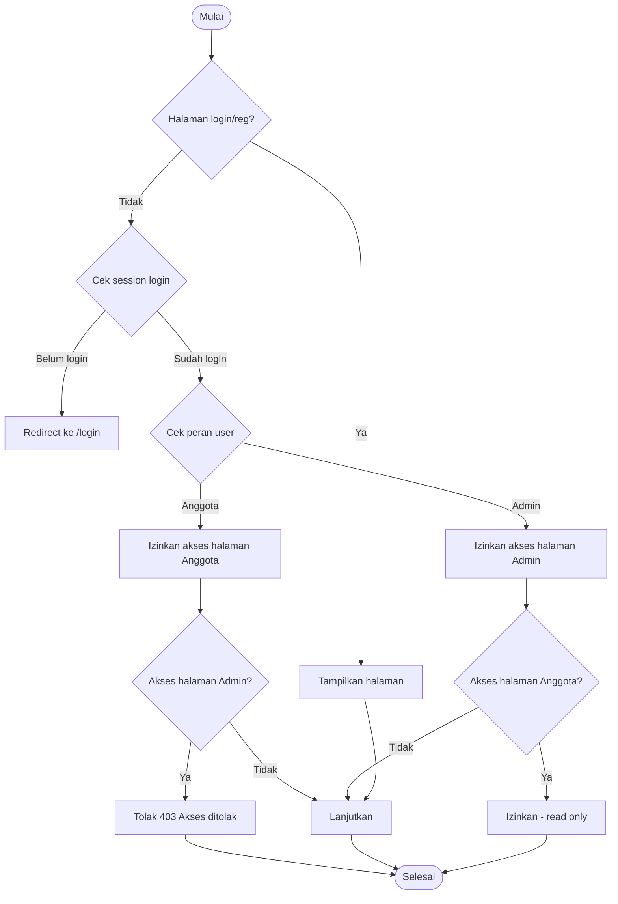
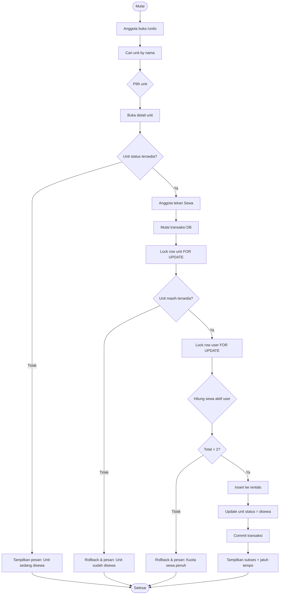
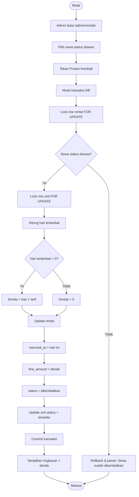
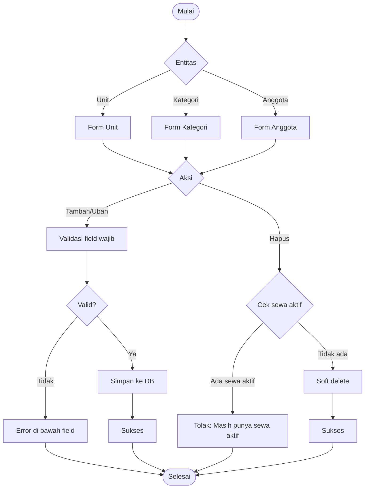
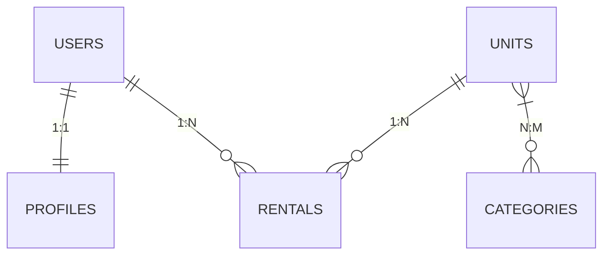

# Flowchart & ERD — XenoRent

Oct 22, 2026 · @Muhammad Fazly Radithya

## 1. Konvensi

Dokumen ini menurunkan proses bisnis BRD menjadi 4 flowchart dan merancang database dengan 6 tabel inti. Nama tabel dan kolom memakai bahasa Inggris (konvensi Laravel), sedangkan nilai status dan semua teks di layar memakai Bahasa Indonesia.

### Pemetaan istilah BRD ke database

| Istilah BRD | Tabel / kolom | Keterangan |
|-------------|---------------|------------|
| Akun (Admin/Anggota) | users, kolom role | Nilai admin atau anggota |
| Profil | profiles | Satu akun tepat satu profil |
| Unit (kapal alien) | units | Dibedakan oleh code yang unik |
| Kategori | categories | Nama kategori unik |
| Unit ↔ kategori | category_unit | Tabel pivot; nama tunggal dan urut abjad sesuai konvensi Laravel |
| Sewa | rentals | Satu baris = satu anggota menyewa satu unit |
| Status unit | units.status | tersedia / disewa |
| Status sewa | rentals.status | disewa / dikembalikan |

### Simbol flowchart (mengikuti simbol dasar ANSI/ISO 5807)

| Simbol | Arti |
|--------|------|
| Kapsul (oval) | Mulai atau selesai |
| Persegi panjang | Proses atau aksi |
| Belah ketupat | Keputusan ya/tidak |
| Panah | Arah alur |
| Kotak berwarna | Langkah yang mengubah database |

## 2. Flowchart 1 — Registrasi, Login & Akses

Semua halaman selain login dan registrasi mewajibkan login (BR-01). Registrasi mandiri selalu menghasilkan akun berperan Anggota beserta profilnya (BR-02, BR-04).



*Flowchart 1 · registrasi, login, dan akses per peran*

Jika form registrasi tidak valid, pesan error tampil dan pengguna memperbaiki isian. Anggota yang mencoba membuka halaman khusus Admin akan ditolak dengan pesan "Akses ditolak" (kode 403).

## 3. Flowchart 2 — Anggota Menyewa Unit

Pengecekan status unit dan kuota terjadi di dalam satu transaksi database (BR-12, ATB-01 s.d. ATB-04). Kotak berwarna adalah langkah yang mengubah database.



*Flowchart 2 · anggota menyewa unit*

Karena baris dikunci selama transaksi, dua anggota yang menekan Sewa pada unit yang sama di waktu bersamaan tidak bisa sama-sama berhasil. Tanggal sewa dan jatuh tempo diisi sistem, bukan diketik anggota.

## 4. Flowchart 3 — Admin Memproses Pengembalian

Pengembalian hanya bisa dilakukan Admin (BR-14) dan denda dihitung otomatis (ATB-05). Seluruh langkah berwarna berjalan dalam satu transaksi.



*Flowchart 3 · admin memproses pengembalian*

Pengecekan status di awal mencegah satu sewa diproses dua kali. Contoh: jatuh tempo 6 November, dikembalikan 8 November, maka denda = 2 hari × tarif per hari.

## 5. Flowchart 4 — Admin Mengelola Unit, Kategori & Anggota

Satu pola dipakai untuk ketiga data (BR-09 s.d. BR-11): tambah dan ubah melewati validasi, hapus melewati pengecekan sewa aktif (ATB-08, ATB-09).



*Flowchart 4 · admin mengelola unit, kategori, dan anggota*

Pengecekan sewa aktif hanya berlaku untuk unit dan anggota. Kategori selalu bisa dihapus; kaitannya ke unit ikut terlepas, sedangkan unitnya tetap ada. Saat Admin menambah anggota, profil anggota ikut dibuat seperti pada registrasi.

## 6. Alur Pendukung

Empat alur berikut berjalan lurus tanpa percabangan penting, jadi cukup ditulis sebagai langkah berurutan.

### A. Mencari unit berdasarkan nama (Admin dan Anggota, BR-08)

1. Pengguna mengetik kata kunci di kolom pencarian halaman daftar unit.
2. Sistem mencari unit yang namanya mengandung kata tersebut, tanpa membedakan huruf besar-kecil.
3. Hasil tampil dengan kode unit, nama, kategori, dan status.
4. Jika tidak ada hasil, tampil pesan "Unit tidak ditemukan".

### B. Mengubah profil sendiri (BR-04, BR-05)

1. Pengguna membuka halaman Profil; form terisi data saat ini.
2. Pengguna mengubah data, lalu menekan Simpan.
3. Sistem memvalidasi field wajib. Jika gagal, pesan error tampil di bawah field dan isian lain tetap ada.
4. Sistem menyimpan ke profil milik akun yang sedang login. ID profil diambil dari sesi login, bukan dari form, sehingga profil orang lain tidak bisa diubah.

### C. Melihat daftar unit yang sedang disewa (BR-15, BR-16)

1. Admin membuka menu Sewa Aktif dan melihat semua sewa berstatus disewa, lengkap dengan nama anggota, unit, tanggal sewa, dan jatuh tempo.
2. Anggota membuka menu Sewa Saya dan hanya melihat sewa miliknya sendiri, baik yang aktif maupun yang sudah selesai.

### D. Melihat dan mencetak riwayat sewa anggota (BR-17)

1. Admin memilih seorang anggota dari daftar anggota.
2. Sistem menampilkan semua sewa anggota tersebut, termasuk tanggal kembali dan denda.
3. Admin menekan Cetak; sistem membuka tampilan versi cetak.
4. Admin mencetak atau menyimpan sebagai PDF lewat fitur print browser.

## 7. ERD (Entity Relationship Diagram)

Database memakai 6 tabel inti. Tabel rentals (disorot) adalah pusat transaksi yang menghubungkan anggota dengan unit.

```mermaid
erDiagram
    USERS ||--|| PROFILES : "hasOne"
    USERS ||--o{ RENTALS : "hasMany"
    UNITS ||--o{ RENTALS : "hasMany"
    UNITS }|--o{ CATEGORIES : "belongsToMany"
    USERS {
        bigint id PK
        string name
        string email UK
        string password
        enum role "admin,anggota"
        timestamp email_verified_at
        string remember_token
        timestamp created_at
        timestamp updated_at
        timestamp deleted_at
    }
    PROFILES {
        bigint id PK
        bigint user_id FK UK
        string phone
        text address
        timestamp created_at
        timestamp updated_at
    }
    CATEGORIES {
        bigint id PK
        string name UK
        text description
        timestamp created_at
        timestamp updated_at
    }
    UNITS {
        bigint id PK
        string code UK
        string name
        text description
        enum status "tersedia,disewa"
        timestamp created_at
        timestamp updated_at
        timestamp deleted_at
    }
    CATEGORY_UNIT {
        bigint category_id FK PK
        bigint unit_id FK PK
    }
    RENTALS {
        bigint id PK
        bigint user_id FK
        bigint unit_id FK
        date rented_at
        date due_at
        date returned_at
        unsignedInteger fine_amount
        enum status "disewa,dikembalikan"
        timestamp created_at
        timestamp updated_at
    }
```

*ERD · 6 tabel inti XenoRent*

PK = primary key, FK = foreign key, UQ = unik. Satu akun punya tepat satu profil; satu akun dan satu unit bisa punya banyak sewa; unit dan kategori saling terhubung banyak-ke-banyak lewat category_unit. Gambar skema dari database asli (untuk README) diambil setelah migration dijalankan.

## 8. Kamus Data

Kolom bertanda "Wajib" divalidasi sebagai required di form (BR-18). Tipe ditulis sesuai method migration Laravel. Tabel bawaan Laravel (password_reset_tokens, sessions, cache, jobs) dibiarkan apa adanya dan tidak digambar di ERD.

### users — akun login untuk Admin dan Anggota

| Kolom | Tipe | Aturan |
|-------|------|--------|
| id | id() | Primary key |
| name | string(100) | Wajib |
| email | string | Wajib, format email, unik |
| password | string | Wajib, minimal 8 karakter, disimpan sebagai hash |
| role | enum('admin','anggota') | Default anggota; registrasi selalu anggota |
| email_verified_at | timestamp nullable | Bawaan Laravel, tidak dipakai |
| remember_token | rememberToken() | Bawaan Laravel |
| created_at, updated_at | timestamps() | Otomatis |
| deleted_at | softDeletes() | Terisi saat Admin menghapus anggota |

### profiles — data diri anggota, tepat satu per akun

| Kolom | Tipe | Aturan |
|-------|------|--------|
| id | id() | Primary key |
| user_id | foreignId()->unique() | Wajib, ke users.id, unik (menjamin 1 akun = 1 profil) |
| phone | string(20) | Wajib, hanya angka |
| address | text | Wajib |
| created_at, updated_at | timestamps() | Otomatis |

### categories — kategori kapal

| Kolom | Tipe | Aturan |
|-------|------|--------|
| id | id() | Primary key |
| name | string(50) | Wajib, unik |
| description | text nullable | Opsional |
| created_at, updated_at | timestamps() | Otomatis |

### units — kapal alien yang disewakan

| Kolom | Tipe | Aturan |
|-------|------|--------|
| id | id() | Primary key |
| code | string(20) | Wajib, unik di seluruh sistem (contoh ZTS-001) |
| name | string(100) | Wajib, boleh sama dengan unit lain, diberi index untuk pencarian |
| description | text nullable | Opsional |
| status | enum('tersedia','disewa') | Default tersedia; hanya diubah oleh proses sewa dan pengembalian |
| created_at, updated_at | timestamps() | Otomatis |
| deleted_at | softDeletes() | Terisi saat Admin menghapus unit |

Saat membuat atau mengubah unit, Admin wajib memilih minimal 1 kategori.

### category_unit — pivot unit ↔ kategori

| Kolom | Tipe | Aturan |
|-------|------|--------|
| category_id | foreignId() | Ke categories.id, hapus otomatis jika kategori dihapus |
| unit_id | foreignId() | Ke units.id, hapus otomatis jika unit dihapus permanen |
| (category_id, unit_id) | primary key gabungan | Mencegah pasangan ganda |

### rentals — transaksi sewa, satu baris per unit

| Kolom | Tipe | Aturan |
|-------|------|--------|
| id | id() | Primary key |
| user_id | foreignId() | Wajib, ke users.id, tidak bisa dihapus permanen selama ada sewa |
| unit_id | foreignId() | Wajib, ke units.id, tidak bisa dihapus permanen selama ada sewa |
| rented_at | date | Wajib, diisi sistem = tanggal hari ini |
| due_at | date | Wajib, diisi sistem = rented_at + 5 hari |
| returned_at | date nullable | Diisi saat Admin memproses pengembalian |
| fine_amount | unsignedInteger | Default 0; diisi saat pengembalian |
| status | enum('disewa','dikembalikan') | Default disewa |
| created_at, updated_at | timestamps() | Otomatis |

Index tambahan pada rentals: (user_id, status) untuk menghitung kuota, dan (unit_id, status) untuk daftar sewa aktif.

## 9. Relasi & Aturan Integritas

Aturan unik dan relasi dijaga oleh database. Aturan kuota dan status dijaga oleh aplikasi di dalam satu transaksi.



| Relasi | Kardinalitas | Eloquent | Saat induk dihapus |
|--------|--------------|----------|-------------------|
| users → profiles | 1 : 1 | hasOne / belongsTo | Profil ikut terhapus jika akun dihapus permanen |
| users → rentals | 1 : N | hasMany / belongsTo | Ditolak (restrict); akun hanya di-soft delete |
| units → rentals | 1 : N | hasMany / belongsTo | Ditolak (restrict); unit hanya di-soft delete |
| units ↔ categories | N : N lewat category_unit | belongsToMany | Baris pivot ikut terhapus; unit dan kategori lain tetap ada |

### Aturan integritas

| Kode | Aturan integritas | Dijaga oleh | Dasar BRD |
|------|-------------------|-------------|-----------|
| INT-01 | units.code dan users.email unik. Kode atau email milik data yang sudah dihapus juga tidak bisa dipakai ulang. | Database (unique index) | ATB-07, ATB-11 |
| INT-02 | profiles.user_id unik, sehingga satu akun hanya punya satu profil | Database (unique index) | BR-04 |
| INT-03 | Pasangan unit-kategori tidak boleh ganda | Database (primary key gabungan) | BR-06 |
| INT-04 | Sewa ditolak jika anggota sudah punya 2 sewa disewa atau unit tidak berstatus tersedia | Aplikasi: transaksi + kunci baris (lockForUpdate) | ATB-02, ATB-03 |
| INT-05 | Membuat sewa dan mengubah status unit menjadi disewa terjadi dalam satu transaksi | Aplikasi: DB::transaction | NFR-02 |
| INT-06 | Pengembalian mengisi returned_at, fine_amount, status sewa dikembalikan, dan status unit tersedia dalam satu transaksi | Aplikasi: DB::transaction | ATB-05, ATB-06 |
| INT-07 | Unit atau anggota yang masih punya sewa disewa tidak bisa dihapus | Aplikasi: cek sebelum hapus | ATB-08 |
| INT-08 | Riwayat sewa tetap utuh setelah unit atau anggota dihapus, karena keduanya hanya di-soft delete | Model: trait SoftDeletes | ATB-08 |
| INT-09 | Durasi 5 hari dan tarif denda dibaca dari konfigurasi aplikasi | Aplikasi: file config + .env | NFR-07 |

## 10. Ringkasan Keputusan

Lima keputusan berikut menjadi acuan untuk PRD, struktur proyek, migration, dan seed.

1. Enam tabel inti dengan nama baku: users, profiles, categories, units, category_unit, rentals. Peran disimpan di kolom users.role, bukan tabel terpisah.
2. Profil dibuat bersamaan dengan registrasi, sehingga form daftar meminta nama, email, password, telepon, dan alamat. Keunikan profiles.user_id menjamin satu akun satu profil.
3. Unit dan anggota tidak pernah dihapus permanen (soft delete), agar riwayat sewa tetap utuh. Kode unit dan email bekas data terhapus tidak bisa dipakai ulang.
4. Kuota 2 unit dan status unit dicek di dalam transaksi dengan kunci baris, sehingga klik ganda atau dua permintaan bersamaan tidak bisa melewati aturan.
5. Tanggal sewa, jatuh tempo, dan denda bertipe tanggal (date) dan diisi sistem, bukan diketik pengguna. Durasi 5 hari dan tarif denda dibaca dari konfigurasi.

## Sumber

- Laravel 13 Release Notes
- How to Name a Pivot Table in Many-to-Many in Laravel — Laravel Daily
- Pivot Tables and Many-to-Many Relationships — Laravel Daily
- Migrations — Laravel Modules Docs (v13)
- Different Type of Action to Take on Delete in Laravel Migration — DEV Community
- Flowchart Symbols Explained — Creately
- Flowchart Meaning and Symbols — MockFlow