# Hasil UAT — XenoRent

Dibuat otomatis oleh Playwright pada 2026-10-27 04:07:31 UTC. Skenario diturunkan dari BRD, Flowchart & ERD, dan PRD (kode KP, F, S, NFR, TB mengacu ke dokumen tersebut).

## Ringkasan

| | Jumlah |
|---|---|
| Total skenario | 66 |
| Lulus | 66 |
| Lulus dengan catatan (perilaku benar, kalimat pesan berbeda dari PRD) | 0 |
| Gagal | 0 |
| Persentase lulus | 100% |

**Lingkungan uji:** Chromium (Playwright) 1366×768, database SQLite terpisah (`database/uat.sqlite`) yang di-seed ulang sebelum setiap skenario (`php artisan migrate:fresh --seed`).

## Rekap per skenario

### A. Kriteria Penerimaan (KP-01 s.d. KP-33)

| Kode | Fitur | Skenario | Hasil |
|---|---|---|---|
| KP-01 | F-01 | Registrasi anggota dengan data valid | Lulus |
| KP-02 | F-01 | Registrasi dengan email yang sudah dipakai | Lulus |
| KP-03 | F-02 | Login dengan email dan password benar | Lulus |
| KP-04 | F-02 | Login dengan password salah | Lulus |
| KP-05 | F-02 | Tamu membuka halaman selain login/registrasi | Lulus |
| KP-06 | F-02 | Anggota membuka halaman Admin | Lulus |
| KP-07 | F-03 | Pengguna mengubah telepon dan alamat profil sendiri | Lulus |
| KP-07b | F-03 | Profil yang diubah adalah milik akun yang sedang login (ID dari sesi, bukan dari form) | Lulus |
| KP-08 | F-04 | Daftar unit menampilkan kode, nama, kategori, dan status | Lulus |
| KP-09 | F-04 | Tiga unit bernama "Zeta Saucer" tampil terpisah dengan kode berbeda | Lulus |
| KP-10 | F-05 | Pencarian "zeta" menemukan unit tanpa membedakan huruf besar-kecil | Lulus |
| KP-11 | F-05 | Pencarian tanpa hasil menampilkan pesan "Unit tidak ditemukan" | Lulus |
| KP-12 | F-06 | Admin menambah unit dengan kode baru dan 2 kategori | Lulus |
| KP-13 | F-06 | Admin menambah unit dengan kode yang sudah ada | Lulus |
| KP-14 | F-06 | Admin menyimpan unit tanpa memilih kategori | Lulus |
| KP-15 | F-06 | Admin menghapus unit yang sedang disewa | Lulus |
| KP-16 | F-06 | Admin menghapus unit yang tidak sedang disewa; riwayat sewa lama tetap ada | Lulus |
| KP-17 | F-07 | Admin menambah kategori dengan nama yang sudah ada | Lulus |
| KP-18 | F-07 | Admin menghapus kategori yang dipakai beberapa unit | Lulus |
| KP-19 | F-08 | Admin menambah anggota dengan data lengkap | Lulus |
| KP-20 | F-08 | Admin mengubah data anggota dengan password dikosongkan | Lulus |
| KP-21 | F-08 | Admin menghapus anggota yang masih punya sewa aktif | Lulus |
| KP-22 | F-09 | Anggota dengan 0 atau 1 sewa aktif menyewa unit tersedia | Lulus |
| KP-23 | F-09 | Anggota dengan 2 sewa aktif mencoba menyewa lagi | Lulus |
| KP-24 | F-09 | Anggota mencoba menyewa unit berstatus disewa | Lulus |
| KP-25 | F-09 | Admin membuka detail unit: tombol Sewa tidak tampil dan server menolak sewa dari Admin | Lulus |
| KP-26 | F-10 | Sewa Saya hanya menampilkan sewa milik sendiri | Lulus |
| KP-27 | F-11 | Admin membuka Sewa Aktif: semua sewa berstatus disewa dari semua anggota | Lulus |
| KP-28 | F-12 | Admin memproses pengembalian sebelum atau tepat di jatuh tempo | Lulus |
| KP-29 | F-12 | Admin memproses pengembalian 2 hari setelah jatuh tempo | Lulus |
| KP-30 | F-12 | Admin memproses sewa yang sudah dikembalikan | Lulus |
| KP-31 | F-12 | Anggota mencoba memproses pengembalian lewat URL | Lulus |
| KP-32 | F-13 | Admin membuka riwayat sewa dan mengubah tampilan mata uang denda | Lulus |
| KP-33 | F-13 | Admin menekan Cetak: tampilan cetak tanpa menu navigasi dan siap disimpan sebagai PDF | Lulus |

### B. Fitur pendukung (login, logout, profil, fitur Must lain)

| Kode | Fitur | Skenario | Hasil |
|---|---|---|---|
| F-02b | F-02 | Logout mengakhiri sesi | Lulus |
| F-06b | F-06 | Admin mengubah data unit dan kategorinya | Lulus |
| F-06c | F-06 | Admin menyimpan perubahan unit dengan kode milik unit lain | Lulus |
| F-07b | F-07 | Admin menambah dan mengubah kategori | Lulus |
| F-08b | F-08 | Admin menghapus anggota tanpa sewa aktif; riwayat sewanya tetap utuh | Lulus |
| F-16 | F-16 | README memuat nama kelompok, nama tim, nama project, fitur, gambar skema database, dan video demo | Lulus |

### C. Fitur Should / Could

| Kode | Fitur | Skenario | Hasil |
|---|---|---|---|
| S-02 | S-02 | Dialog konfirmasi sebelum menghapus | Lulus |
| S-03 | S-03 | Paginasi daftar | Lulus |
| S-05 | S-05, C-03 | Dashboard menampilkan sisa kuota (Anggota) dan angka ringkasan (Admin) | Lulus |

### D. Validasi field per form (F-14, NFR-03)

| Kode | Fitur | Skenario | Hasil |
|---|---|---|---|
| VAL-01 | F-14, F-01 | Validasi form Registrasi | Lulus |
| VAL-02 | F-14, F-02 | Validasi form Login | Lulus |
| VAL-03 | F-14, F-03 | Validasi form Profil | Lulus |
| VAL-04 | F-14, F-06 | Validasi form Unit | Lulus |
| VAL-05 | F-14, F-07 | Validasi form Kategori | Lulus |
| VAL-06 | F-14, F-08 | Validasi form Anggota (Admin) | Lulus |
| VAL-06b | F-14, F-08 | Validasi ubah anggota: email milik anggota lain ditolak | Lulus |
| VAL-07 | F-14, F-05 | Validasi kata kunci pencarian maksimal 100 karakter | Lulus |

### E. Kondisi tampilan (PRD bagian 8)

| Kode | Fitur | Skenario | Hasil |
|---|---|---|---|
| KT-01 | F-10 | Sewa Saya kosong untuk anggota yang belum pernah menyewa | Lulus |
| KT-02 | F-11 | Sewa Aktif kosong setelah semua unit dikembalikan | Lulus |
| KT-03 | F-13 | Riwayat anggota kosong: tombol Cetak nonaktif | Lulus |
| KT-04 | F-04 | Daftar unit kosong | Lulus |
| KT-05 | PRD halaman 14 | Halaman 404 untuk data yang tidak ada | Lulus |
| KT-06 | S-01 | Tombol kirim nonaktif dan berlabel "Memproses..." sehingga klik ganda tidak membuat sewa ganda | Lulus |

### F. Tujuan bisnis (BRD bagian 3)

| Kode | Fitur | Skenario | Hasil |
|---|---|---|---|
| TB-03 | F-12 | Denda sistem sama dengan hitungan manual di semua skenario keterlambatan | Lulus |

### G. Kebutuhan non-fungsional (BRD bagian 6)

| Kode | Fitur | Skenario | Hasil |
|---|---|---|---|
| NFR-01 | NFR-01 | Password disimpan sebagai hash; halaman dilindungi login dan peran di server | Lulus |
| NFR-02 | NFR-02 | Permintaan sewa beruntun tidak bisa melewati kuota 2 unit | Lulus |
| NFR-04 | NFR-04, S-04 | Tampilan dapat dipakai di layar HP (lebar 390 px) tanpa scroll horizontal halaman | Lulus |
| NFR-07 | NFR-07 | Tarif denda dan durasi sewa dibaca dari konfigurasi, bukan ditulis di kode | Lulus |
| NFR-08 | NFR-08, F-15 | migrate:fresh --seed membangun ulang database dengan data seed sesuai PRD | Lulus |

### H. Integritas data (Flowchart & ERD bagian 9)

| Kode | Fitur | Skenario | Hasil |
|---|---|---|---|
| INT-01 | INT-01 | Kode unit dan email unik di level database, termasuk bekas data terhapus | Lulus |
| INT-02 | INT-02, INT-03 | Satu akun satu profil dan pasangan unit-kategori tidak ganda | Lulus |
| INT-03 | INT-07, INT-08 | Foreign key rentals bersifat restrict: akun/unit dengan sewa tidak bisa dihapus permanen | Lulus |

## Detail skenario dan bukti

### A. Kriteria Penerimaan (KP-01 s.d. KP-33)

#### KP-01 — Registrasi anggota dengan data valid

- **Fitur / referensi:** F-01 · BR-02, BR-04, ATB-11
- **Hasil:** Lulus
- **Langkah:**
  1. Buka /register sebagai tamu.
  2. Isi nama, email, password, konfirmasi password, telepon, dan alamat dengan data valid.
  3. Tekan "Daftar sebagai anggota".
- **Hasil yang diharapkan:** Akun berperan anggota dan profilnya tersimpan; pengguna langsung login dan masuk Dashboard Anggota dengan sisa kuota 2 dari 2.

*Form registrasi terisi data valid* — `KP-01_01_form-registrasi-terisi-data-valid.png`

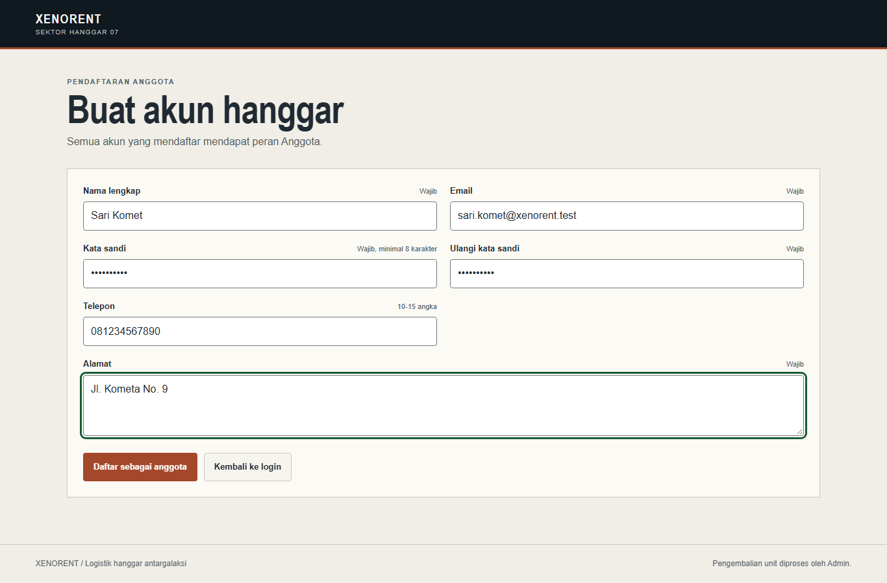

*Dashboard anggota setelah registrasi, sisa kuota 2 dari 2* — `KP-01_02_dashboard-anggota-setelah-registrasi-sisa-kuota-2-dari-2.png`

#### KP-02 — Registrasi dengan email yang sudah dipakai

- **Fitur / referensi:** F-01 · BR-04, ATB-11, NFR-02, NFR-03
- **Hasil:** Lulus
- **Langkah:**
  1. Buka /register sebagai tamu.
  2. Isi form dengan email rina@xenorent.test yang sudah terdaftar.
  3. Tekan "Daftar sebagai anggota".
- **Hasil yang diharapkan:** Registrasi ditolak dengan pesan "Email sudah terdaftar"; akun tidak bertambah dan isian lain tidak hilang.

*Registrasi ditolak karena email sudah dipakai, isian lain tetap terisi* — `KP-02_01_registrasi-ditolak-karena-email-sudah-dipakai-isian-lain-tetap-terisi.png`

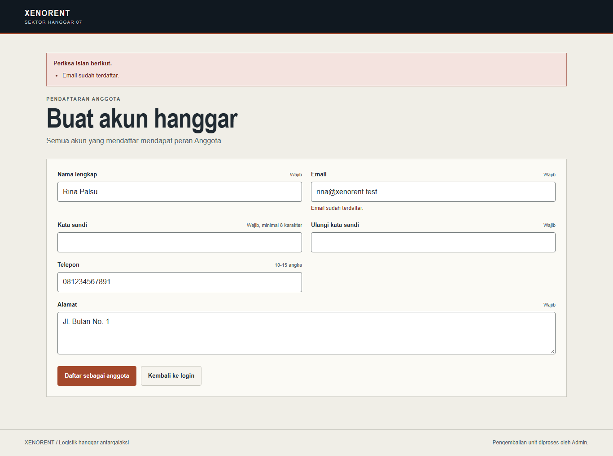

#### KP-03 — Login dengan email dan password benar

- **Fitur / referensi:** F-02 · BR-01
- **Hasil:** Lulus
- **Langkah:**
  1. Buka /login lalu login sebagai Admin.
  2. Keluar, lalu login sebagai Anggota (Rina) dan Anggota (Bima).
- **Hasil yang diharapkan:** Admin masuk ke Dashboard Admin; Anggota masuk ke Dashboard Anggota.

*Form login diisi akun Admin* — `KP-03_01_form-login-diisi-akun-admin.png`

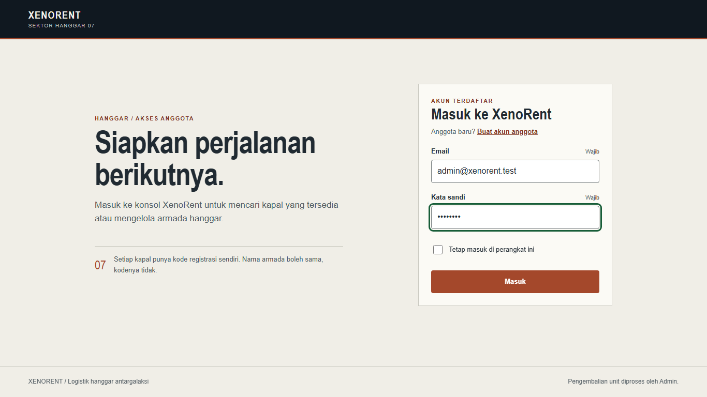

*Dashboard Admin setelah login* — `KP-03_02_dashboard-admin-setelah-login.png`

*Dashboard Anggota (Rina) setelah login* — `KP-03_03_dashboard-anggota-rina-setelah-login.png`

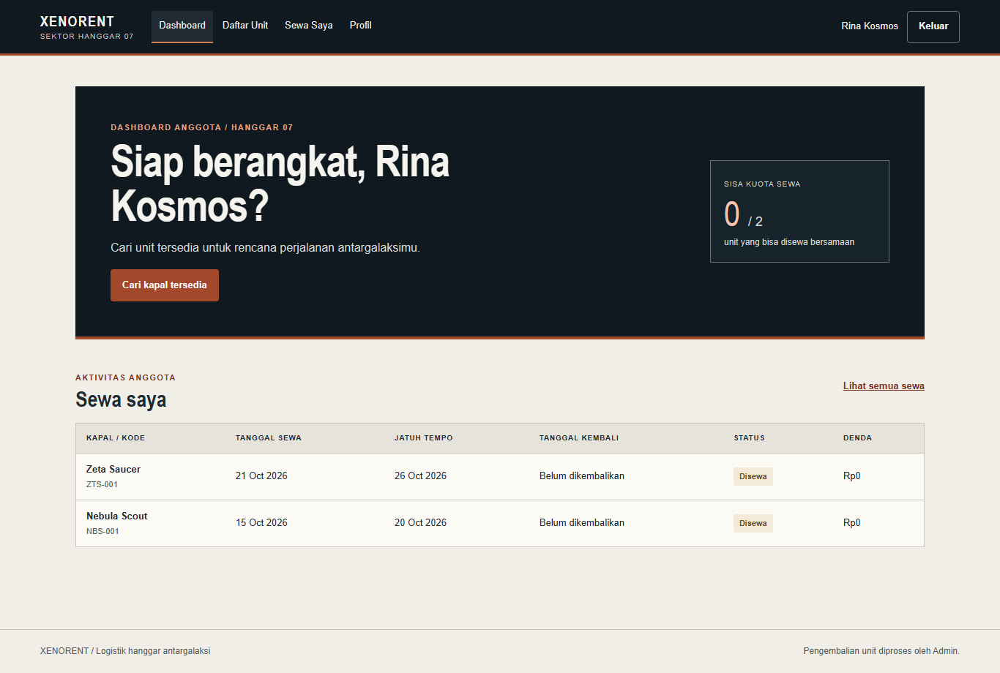

#### KP-04 — Login dengan password salah

- **Fitur / referensi:** F-02 · NFR-01
- **Hasil:** Lulus
- **Langkah:**
  1. Buka /login.
  2. Isi email admin@xenorent.test dengan password yang salah.
  3. Tekan "Masuk".
- **Hasil yang diharapkan:** Tetap di halaman login dengan pesan gagal; password tidak ditampilkan ulang.

*Login gagal: pesan tampil dan kolom password kosong kembali* — `KP-04_01_login-gagal-pesan-tampil-dan-kolom-password-kosong-kembali.png`

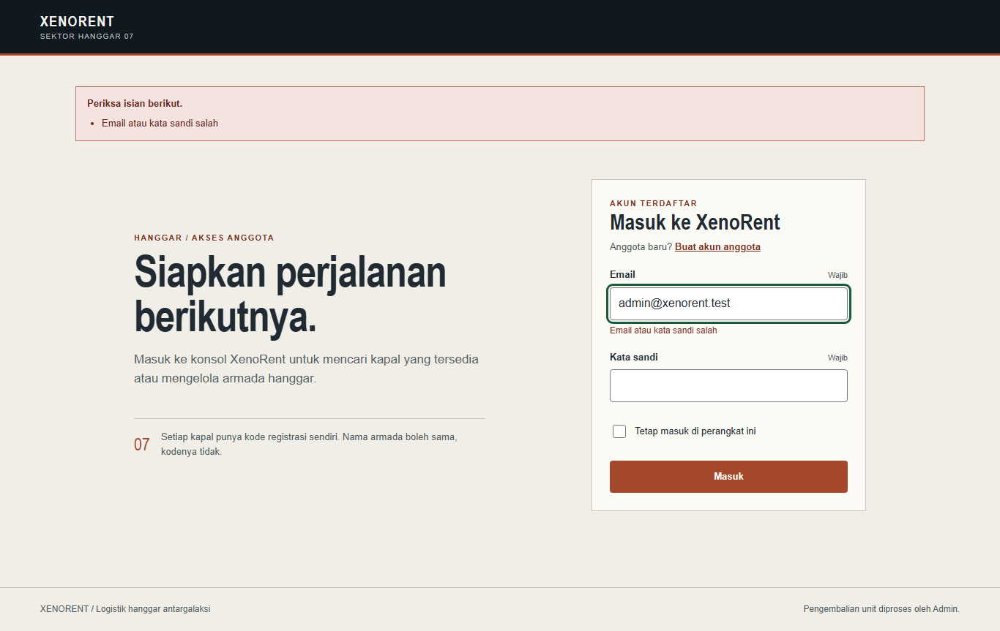

#### KP-05 — Tamu membuka halaman selain login/registrasi

- **Fitur / referensi:** F-02 · BR-01, NFR-01
- **Hasil:** Lulus
- **Langkah:**
  1. Tanpa login, buka URL /dashboard, /units, /units/1, /profile, /rentals/mine, dan seluruh halaman /admin/*.
- **Hasil yang diharapkan:** Setiap URL mengarahkan tamu ke halaman login.

*Tamu membuka /dashboard diarahkan ke login* — `KP-05_01_tamu-membuka-dashboard-diarahkan-ke-login.png`

*Tamu membuka /admin/units diarahkan ke login* — `KP-05_02_tamu-membuka-admin-units-diarahkan-ke-login.png`

#### KP-06 — Anggota membuka halaman Admin

- **Fitur / referensi:** F-02 · BR-01, TB-04, NFR-01
- **Hasil:** Lulus
- **Langkah:**
  1. Login sebagai Anggota (Rina).
  2. Buka /admin/units, /admin/categories, /admin/members, /admin/rentals/active, dan riwayat sewa anggota.
- **Hasil yang diharapkan:** Setiap URL ditolak dengan halaman "Akses ditolak" (403) berikut tombol kembali ke Dashboard.

*Anggota membuka /admin/units: halaman Akses ditolak (403)* — `KP-06_01_anggota-membuka-admin-units-halaman-akses-ditolak-403.png`

#### KP-07 — Pengguna mengubah telepon dan alamat profil sendiri

- **Fitur / referensi:** F-03 · BR-05, TB-04
- **Hasil:** Lulus
- **Langkah:**
  1. Login sebagai Rina.
  2. Buka menu Profil.
  3. Ubah telepon dan alamat lalu tekan "Simpan profil".
- **Hasil yang diharapkan:** Data profil Rina tersimpan dan tampil di form; profil anggota lain tidak berubah.

*Halaman profil Rina sebelum diubah* — `KP-07_01_halaman-profil-rina-sebelum-diubah.png`

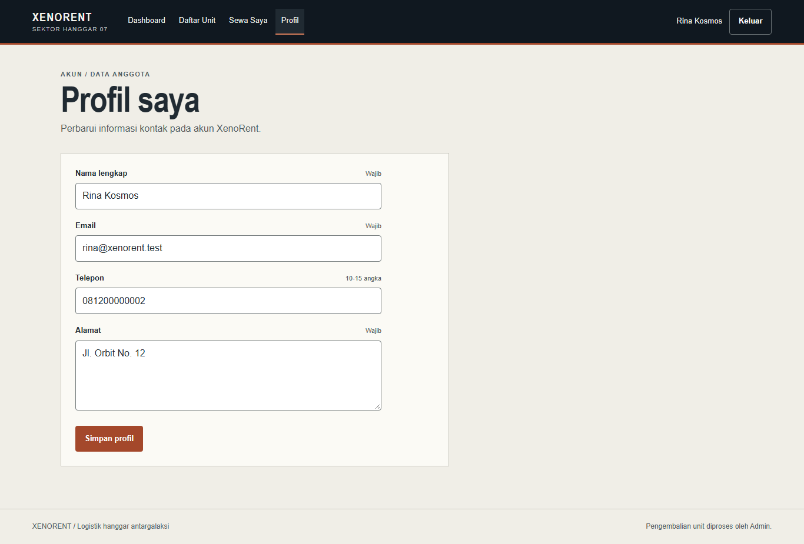

*Profil Rina tersimpan dengan pesan sukses* — `KP-07_02_profil-rina-tersimpan-dengan-pesan-sukses.png`

#### KP-07b — Profil yang diubah adalah milik akun yang sedang login (ID dari sesi, bukan dari form)

- **Fitur / referensi:** F-03 · BR-05, Flowchart 6B
- **Hasil:** Lulus
- **Langkah:**
  1. Login sebagai Rina.
  2. Buka Profil dan kirim form dengan tambahan field user_id milik Bima.
  3. Periksa profil Bima.
- **Hasil yang diharapkan:** Profil Bima tetap sama; hanya profil Rina yang berubah.

*Profil Rina diubah dengan field user_id Bima disisipkan* — `KP-07b_01_profil-rina-diubah-dengan-field-user-id-bima-disisipkan.png`

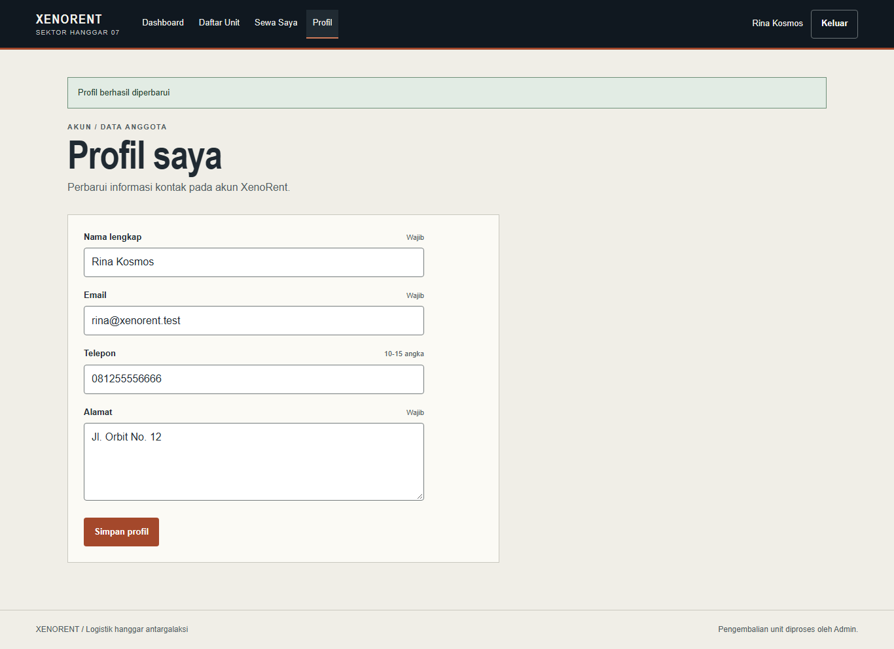

#### KP-08 — Daftar unit menampilkan kode, nama, kategori, dan status

- **Fitur / referensi:** F-04 · BR-06, BR-07
- **Hasil:** Lulus
- **Langkah:**
  1. Login sebagai Anggota (Bima).
  2. Buka menu Daftar Unit.
- **Hasil yang diharapkan:** Tampil 10 unit seed; setiap unit memuat kode, nama, kategori, dan status.

*Daftar unit: 10 unit lengkap dengan kode, nama, kategori, dan status* — `KP-08_01_daftar-unit-10-unit-lengkap-dengan-kode-nama-kategori-dan-status.png`

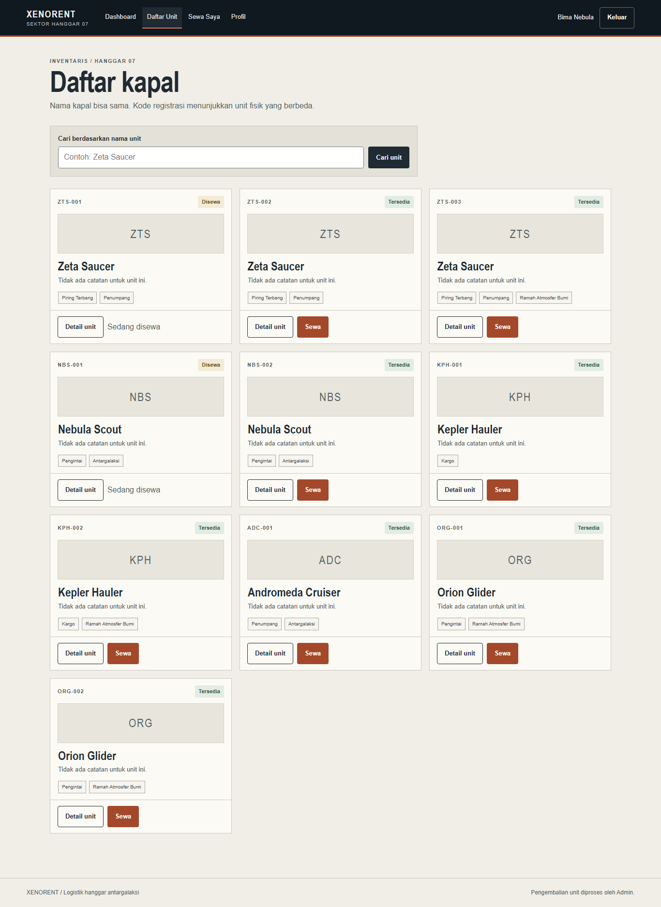

#### KP-09 — Tiga unit bernama "Zeta Saucer" tampil terpisah dengan kode berbeda

- **Fitur / referensi:** F-04 · BR-07, ATB-07, TB-01
- **Hasil:** Lulus
- **Langkah:**
  1. Login sebagai Anggota.
  2. Buka Daftar Unit dan perhatikan unit bernama Zeta Saucer.
- **Hasil yang diharapkan:** Tiga kartu "Zeta Saucer" tampil terpisah dengan kode ZTS-001, ZTS-002, ZTS-003.

*Tiga Zeta Saucer dengan kode unik berbeda* — `KP-09_01_tiga-zeta-saucer-dengan-kode-unik-berbeda.png`

#### KP-10 — Pencarian "zeta" menemukan unit tanpa membedakan huruf besar-kecil

- **Fitur / referensi:** F-05 · BR-08, ATB-10
- **Hasil:** Lulus
- **Langkah:**
  1. Login sebagai Anggota.
  2. Di Daftar Unit cari "zeta", lalu "ZETA", "zEtA", dan sebagian kata "saucer".
- **Hasil yang diharapkan:** Semua unit yang namanya mengandung "Zeta" tampil, untuk huruf besar maupun kecil dan pencocokan sebagian.

*Hasil pencarian "zeta": tiga Zeta Saucer* — `KP-10_01_hasil-pencarian-zeta-tiga-zeta-saucer.png`

*Hasil pencarian "ZETA" (huruf besar) sama dengan "zeta"* — `KP-10_02_hasil-pencarian-zeta-huruf-besar-sama-dengan-zeta.png`

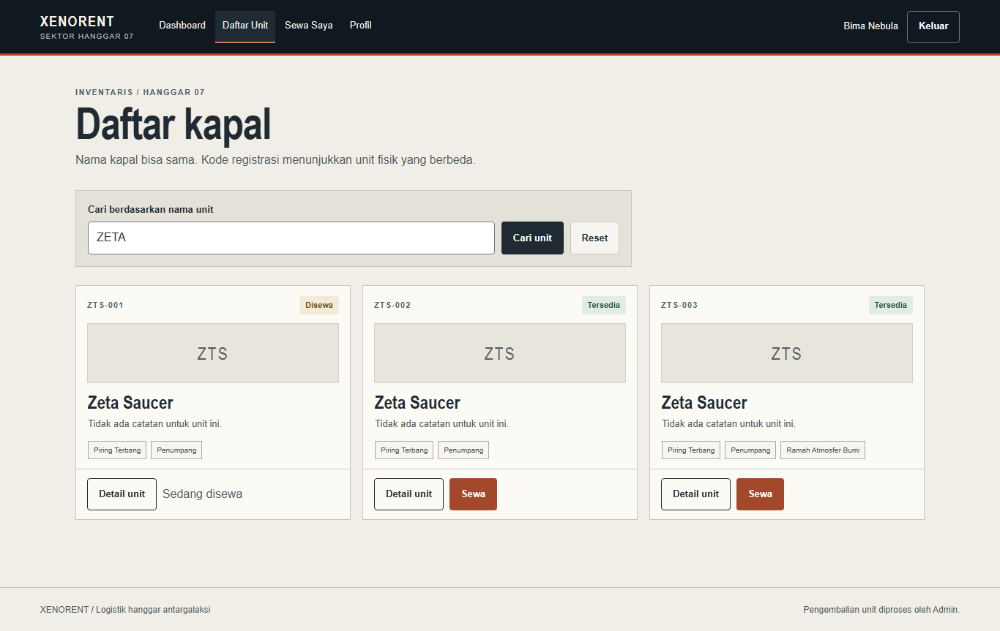

#### KP-11 — Pencarian tanpa hasil menampilkan pesan "Unit tidak ditemukan"

- **Fitur / referensi:** F-05 · BR-08
- **Hasil:** Lulus
- **Langkah:**
  1. Login sebagai Anggota.
  2. Cari kata "xyzabc" yang tidak cocok dengan unit mana pun.
- **Hasil yang diharapkan:** Tampil pesan "Unit tidak ditemukan" beserta tautan Reset.

*Pencarian "xyzabc": pesan Unit tidak ditemukan dengan tautan Reset* — `KP-11_01_pencarian-xyzabc-pesan-unit-tidak-ditemukan-dengan-tautan-reset.png`

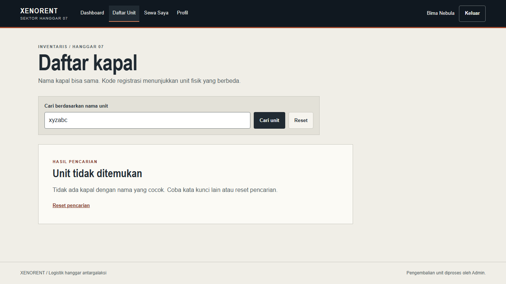

#### KP-12 — Admin menambah unit dengan kode baru dan 2 kategori

- **Fitur / referensi:** F-06 · BR-06, BR-09, TB-01
- **Hasil:** Lulus
- **Langkah:**
  1. Login sebagai Admin lalu buka Kelola Unit.
  2. Isi kode ZTS-004, nama Zeta Saucer, deskripsi, dan centang kategori Piring Terbang serta Penumpang.
  3. Tekan "Tambah unit".
- **Hasil yang diharapkan:** Unit tersimpan berstatus tersedia dengan 2 kategori dan tampil di daftar.

*Form tambah unit terisi (kode ZTS-004, 2 kategori)* — `KP-12_01_form-tambah-unit-terisi-kode-zts-004-2-kategori.png`

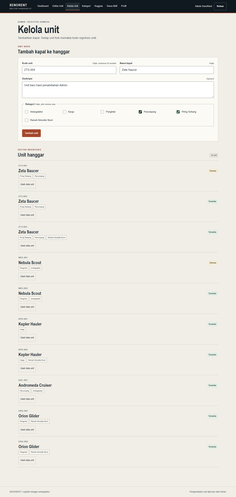

*Unit ZTS-004 tersimpan: tersedia, 2 kategori* — `KP-12_02_unit-zts-004-tersimpan-tersedia-2-kategori.png`

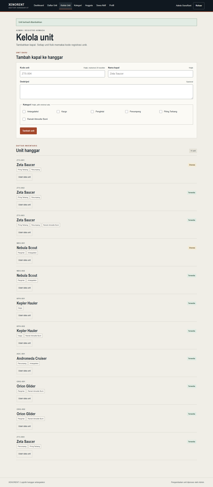

#### KP-13 — Admin menambah unit dengan kode yang sudah ada

- **Fitur / referensi:** F-06 · BR-07, ATB-07, TB-01, NFR-02
- **Hasil:** Lulus
- **Langkah:**
  1. Login sebagai Admin lalu buka Kelola Unit.
  2. Isi kode ZTS-001 (sudah dipakai), nama dan kategori, lalu tekan "Tambah unit".
- **Hasil yang diharapkan:** Ditolak dengan pesan "Kode unit sudah dipakai"; tidak ada unit ganda dan isian tetap terisi.

*Kode ZTS-001 ditolak karena sudah dipakai, isian tetap terisi* — `KP-13_01_kode-zts-001-ditolak-karena-sudah-dipakai-isian-tetap-terisi.png`

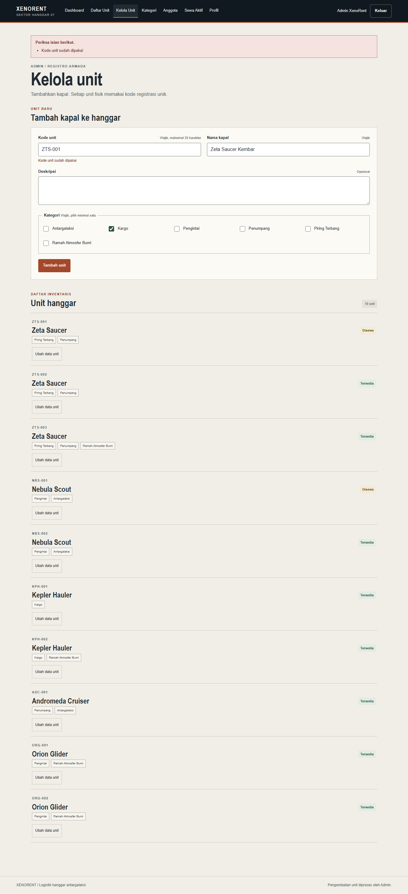

#### KP-14 — Admin menyimpan unit tanpa memilih kategori

- **Fitur / referensi:** F-06 · BR-06, BR-18
- **Hasil:** Lulus
- **Langkah:**
  1. Login sebagai Admin lalu buka Kelola Unit.
  2. Isi kode ZTS-005 dan nama, tanpa mencentang kategori, lalu tekan "Tambah unit".
- **Hasil yang diharapkan:** Ditolak dengan pesan "Pilih minimal 1 kategori"; unit tidak tersimpan.

*Unit tanpa kategori ditolak, isian lain tetap terisi* — `KP-14_01_unit-tanpa-kategori-ditolak-isian-lain-tetap-terisi.png`

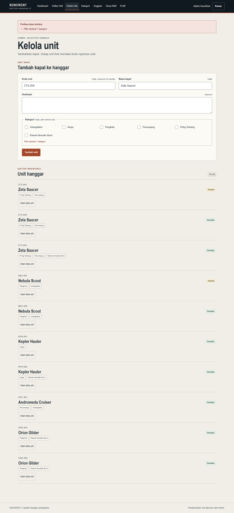

#### KP-15 — Admin menghapus unit yang sedang disewa

- **Fitur / referensi:** F-06 · ATB-08, INT-07
- **Hasil:** Lulus
- **Langkah:**
  1. Login sebagai Admin lalu buka Kelola Unit.
  2. Buka "Ubah data unit" pada ZTS-001 (sedang disewa Rina) dan cari tombol hapus.
  3. Paksa penghapusan lewat permintaan langsung ke URL hapus unit.
- **Hasil yang diharapkan:** Tombol hapus tidak tersedia; jika dipaksa, ditolak dengan pesan "Unit masih disewa" dan unit tetap ada.

*ZTS-001 sedang disewa: tombol Hapus unit tidak tersedia* — `KP-15_01_zts-001-sedang-disewa-tombol-hapus-unit-tidak-tersedia.png`

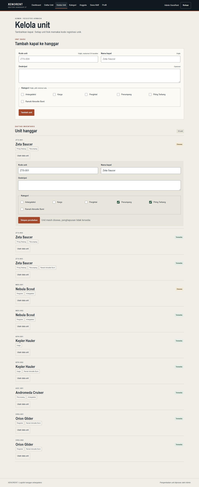

*Penghapusan dipaksa lewat URL ditolak server* — `KP-15_02_penghapusan-dipaksa-lewat-url-ditolak-server.png`

#### KP-16 — Admin menghapus unit yang tidak sedang disewa; riwayat sewa lama tetap ada

- **Fitur / referensi:** F-06 · ATB-08, INT-08, TB-05
- **Hasil:** Lulus
- **Langkah:**
  1. Login sebagai Admin lalu buka Kelola Unit.
  2. Pada KPH-001 (pernah disewa Bima, sudah dikembalikan) buka "Ubah data unit" lalu tekan "Hapus unit" dan setujui konfirmasi.
  3. Buka riwayat sewa Bima.
- **Hasil yang diharapkan:** Unit hilang dari daftar; riwayat sewa Bima untuk unit tersebut tetap tampil.

*Panel ubah unit KPH-001 terbuka dengan tombol Hapus unit* — `KP-16_01_panel-ubah-unit-kph-001-terbuka-dengan-tombol-hapus-unit.png`

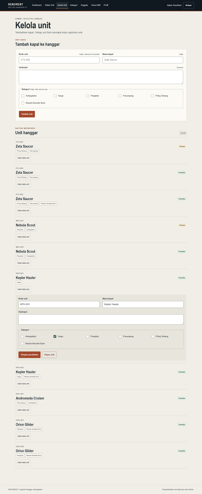

*KPH-001 terhapus dari daftar dengan pesan sukses* — `KP-16_02_kph-001-terhapus-dari-daftar-dengan-pesan-sukses.png`

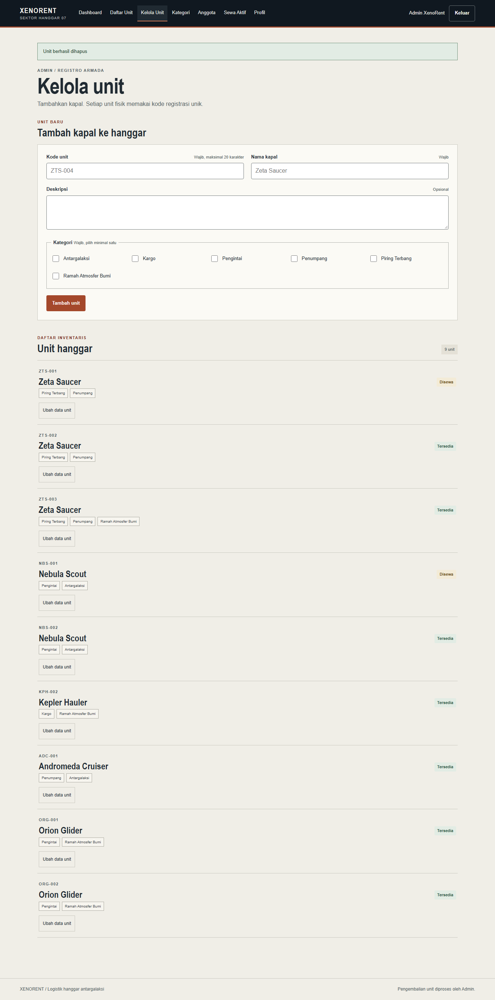

*Riwayat sewa Bima tetap utuh setelah unit KPH-001 dihapus* — `KP-16_03_riwayat-sewa-bima-tetap-utuh-setelah-unit-kph-001-dihapus.png`

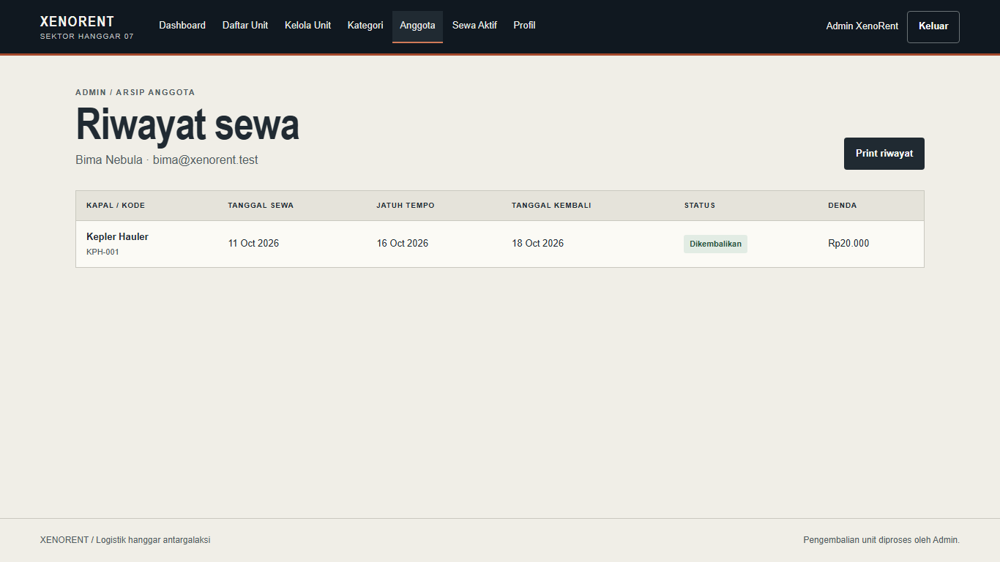

#### KP-17 — Admin menambah kategori dengan nama yang sudah ada

- **Fitur / referensi:** F-07 · BR-10, NFR-02
- **Hasil:** Lulus
- **Langkah:**
  1. Login sebagai Admin lalu buka menu Kategori.
  2. Isi nama "Kargo" (sudah ada) lalu tekan "Tambah kategori".
- **Hasil yang diharapkan:** Ditolak dengan pesan "Nama kategori sudah dipakai"; jumlah kategori tidak bertambah.

*Kategori "Kargo" ditolak karena nama sudah dipakai* — `KP-17_01_kategori-kargo-ditolak-karena-nama-sudah-dipakai.png`

#### KP-18 — Admin menghapus kategori yang dipakai beberapa unit

- **Fitur / referensi:** F-07 · BR-10, ATB-09
- **Hasil:** Lulus
- **Langkah:**
  1. Login sebagai Admin lalu buka menu Kategori.
  2. Pada kategori "Penumpang" (dipakai 4 unit) buka "Ubah kategori", tekan "Hapus kategori", dan setujui konfirmasi.
  3. Buka Daftar Unit.
- **Hasil yang diharapkan:** Kategori terhapus; seluruh 10 unit tetap ada tanpa kategori tersebut.

*Kategori Penumpang (4 unit terhubung) sebelum dihapus* — `KP-18_01_kategori-penumpang-4-unit-terhubung-sebelum-dihapus.png`

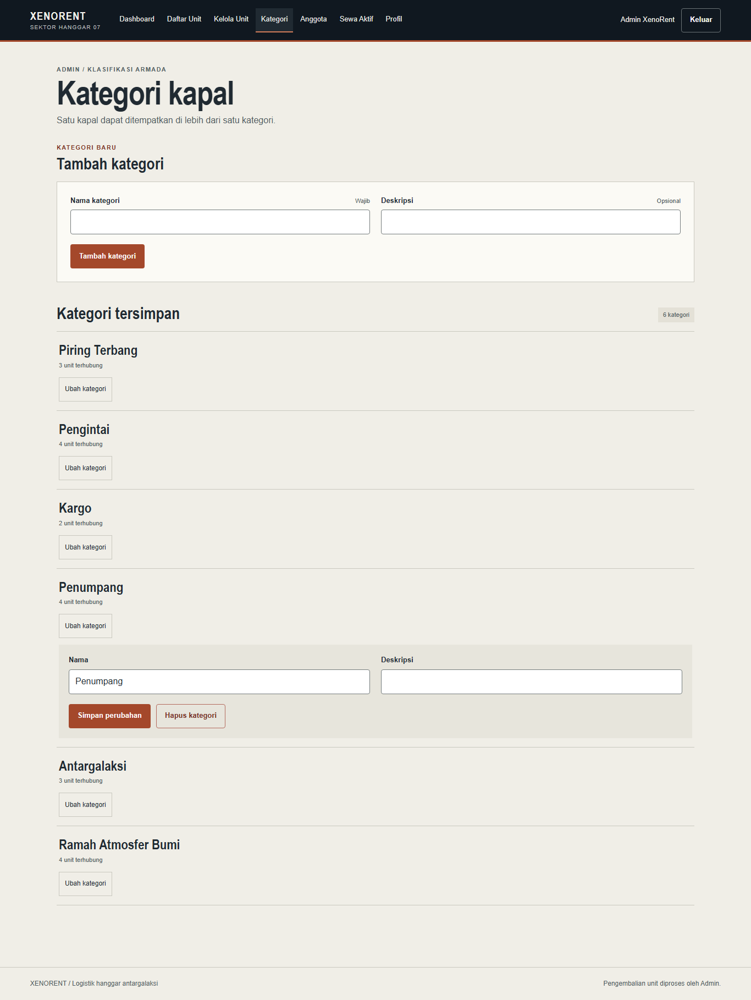

*Kategori Penumpang terhapus dengan pesan sukses* — `KP-18_02_kategori-penumpang-terhapus-dengan-pesan-sukses.png`

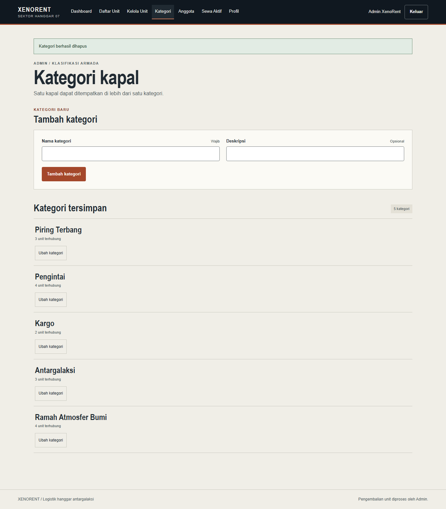

*Seluruh unit tetap ada; tag Penumpang lepas dari unit* — `KP-18_03_seluruh-unit-tetap-ada-tag-penumpang-lepas-dari-unit.png`

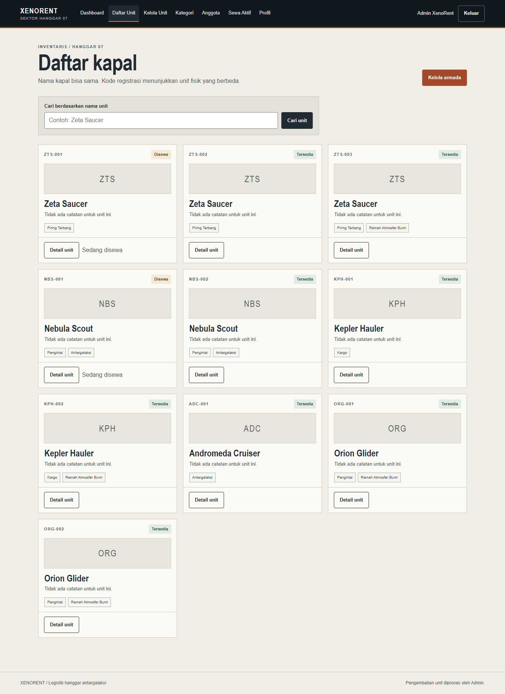

#### KP-19 — Admin menambah anggota dengan data lengkap

- **Fitur / referensi:** F-08 · BR-11, BR-04
- **Hasil:** Lulus
- **Langkah:**
  1. Login sebagai Admin lalu buka menu Anggota.
  2. Isi nama, email, telepon, alamat, password, dan konfirmasi password lalu tekan "Tambah anggota".
  3. Keluar, lalu login memakai akun anggota baru tersebut.
- **Hasil yang diharapkan:** Akun anggota dan profilnya tersimpan; anggota baru bisa login ke Dashboard Anggota.

*Form tambah anggota terisi lengkap* — `KP-19_01_form-tambah-anggota-terisi-lengkap.png`

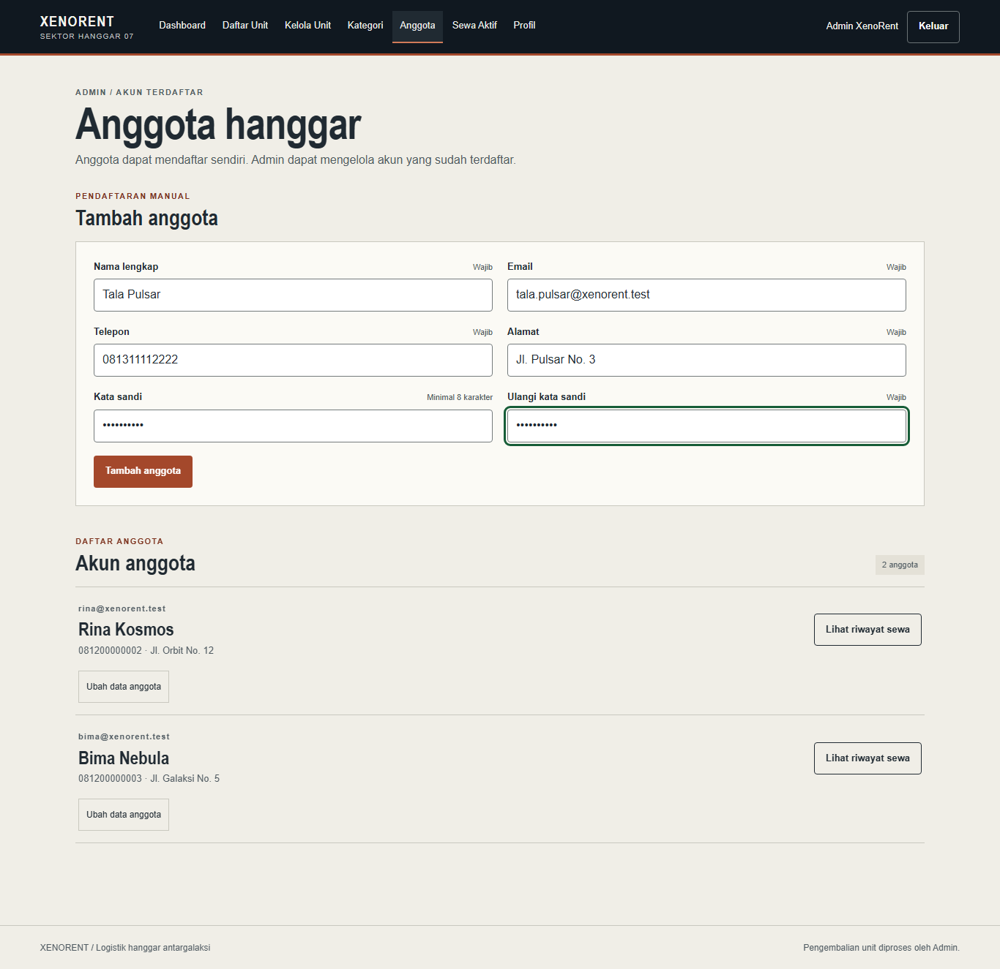

*Anggota baru tampil di daftar dengan pesan sukses* — `KP-19_02_anggota-baru-tampil-di-daftar-dengan-pesan-sukses.png`

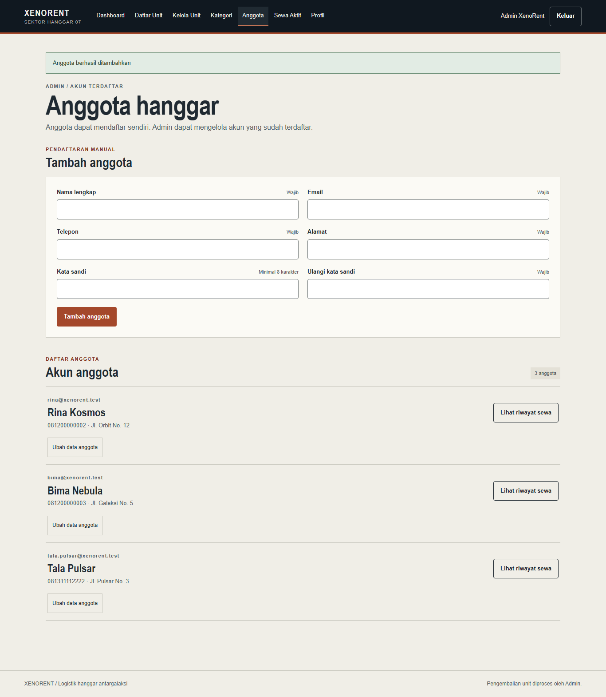

*Anggota baru berhasil login ke Dashboard Anggota* — `KP-19_03_anggota-baru-berhasil-login-ke-dashboard-anggota.png`

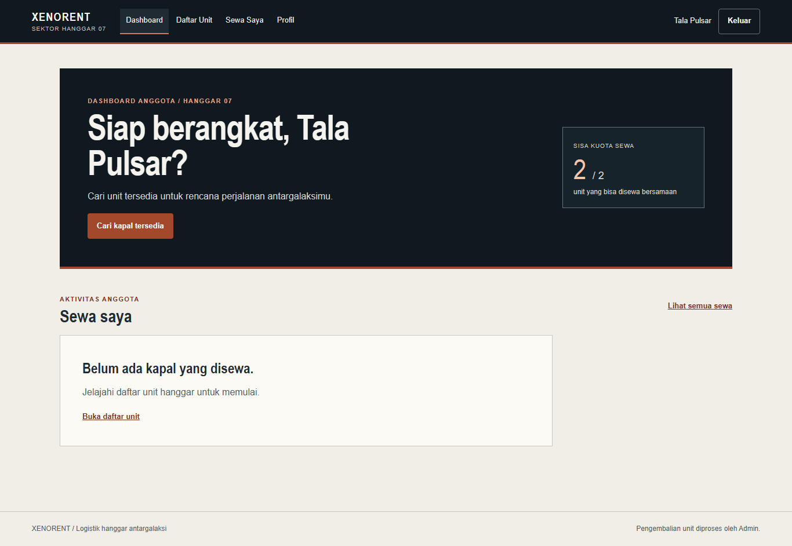

#### KP-20 — Admin mengubah data anggota dengan password dikosongkan

- **Fitur / referensi:** F-08 · BR-11, NFR-01
- **Hasil:** Lulus
- **Langkah:**
  1. Login sebagai Admin lalu buka menu Anggota.
  2. Buka "Ubah data anggota" pada Bima, ubah nama dan telepon, biarkan password kosong, lalu simpan.
  3. Keluar dan login sebagai Bima memakai password lama.
- **Hasil yang diharapkan:** Nama dan telepon tersimpan; password lama tetap berlaku.

*Form ubah anggota Bima, kolom password dikosongkan* — `KP-20_01_form-ubah-anggota-bima-kolom-password-dikosongkan.png`

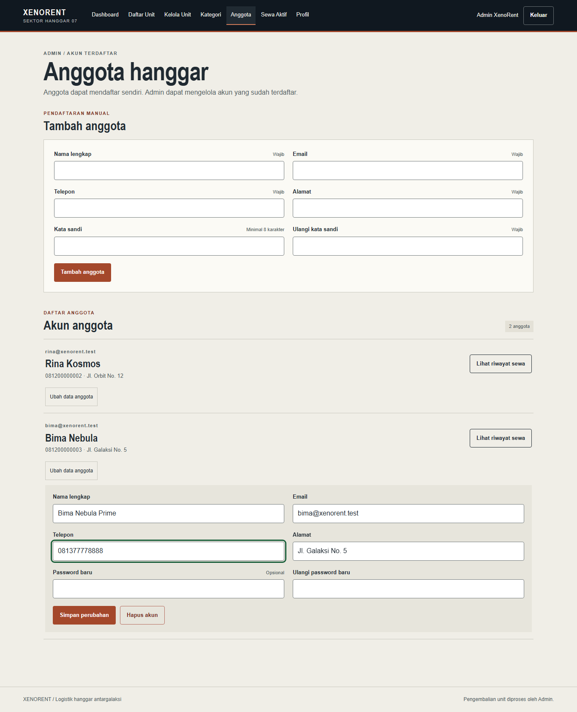

*Data Bima tersimpan dengan pesan sukses* — `KP-20_02_data-bima-tersimpan-dengan-pesan-sukses.png`

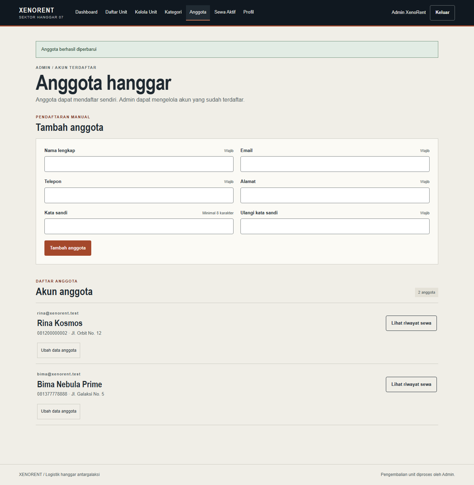

*Bima masih bisa login dengan password lama* — `KP-20_03_bima-masih-bisa-login-dengan-password-lama.png`

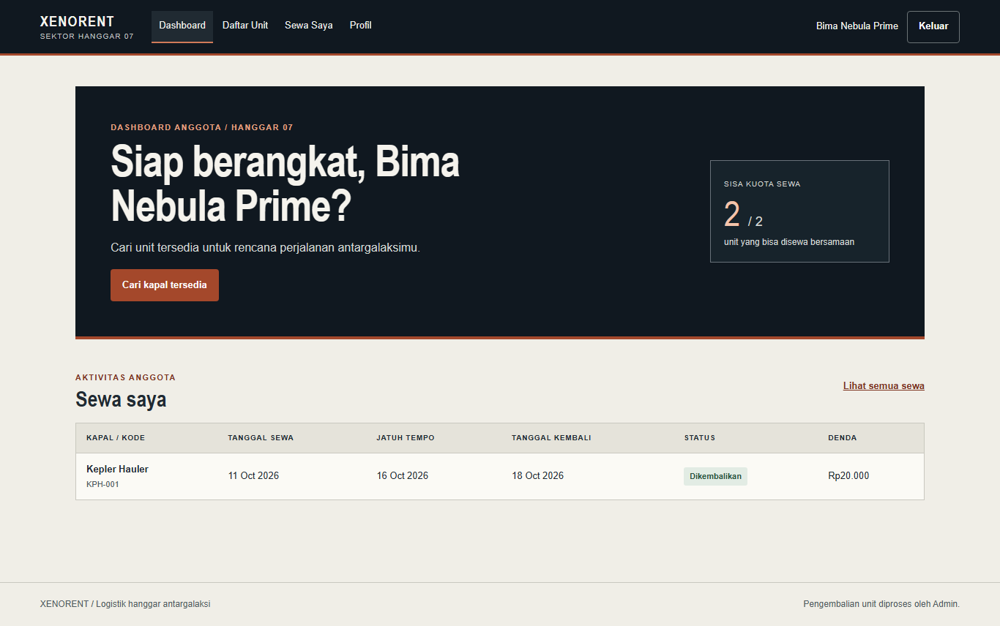

#### KP-21 — Admin menghapus anggota yang masih punya sewa aktif

- **Fitur / referensi:** F-08 · ATB-08, INT-07
- **Hasil:** Lulus
- **Langkah:**
  1. Login sebagai Admin lalu buka menu Anggota.
  2. Buka "Ubah data anggota" pada Rina (2 sewa aktif) dan cari tombol hapus.
  3. Paksa penghapusan lewat permintaan langsung ke URL hapus anggota.
- **Hasil yang diharapkan:** Tombol hapus tidak tersedia; jika dipaksa, ditolak dengan pesan "Anggota masih punya sewa aktif" dan akun tetap ada.

*Rina punya sewa aktif: tombol Hapus akun tidak tersedia* — `KP-21_01_rina-punya-sewa-aktif-tombol-hapus-akun-tidak-tersedia.png`

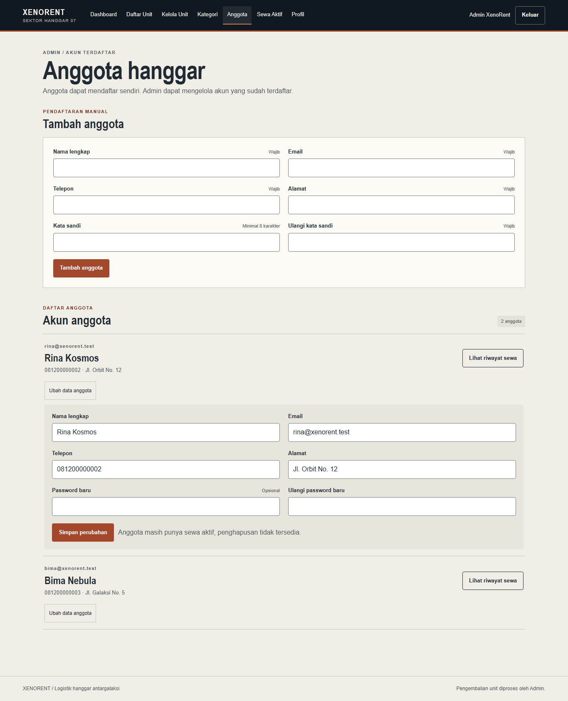

*Penghapusan dipaksa lewat URL ditolak server* — `KP-21_02_penghapusan-dipaksa-lewat-url-ditolak-server.png`

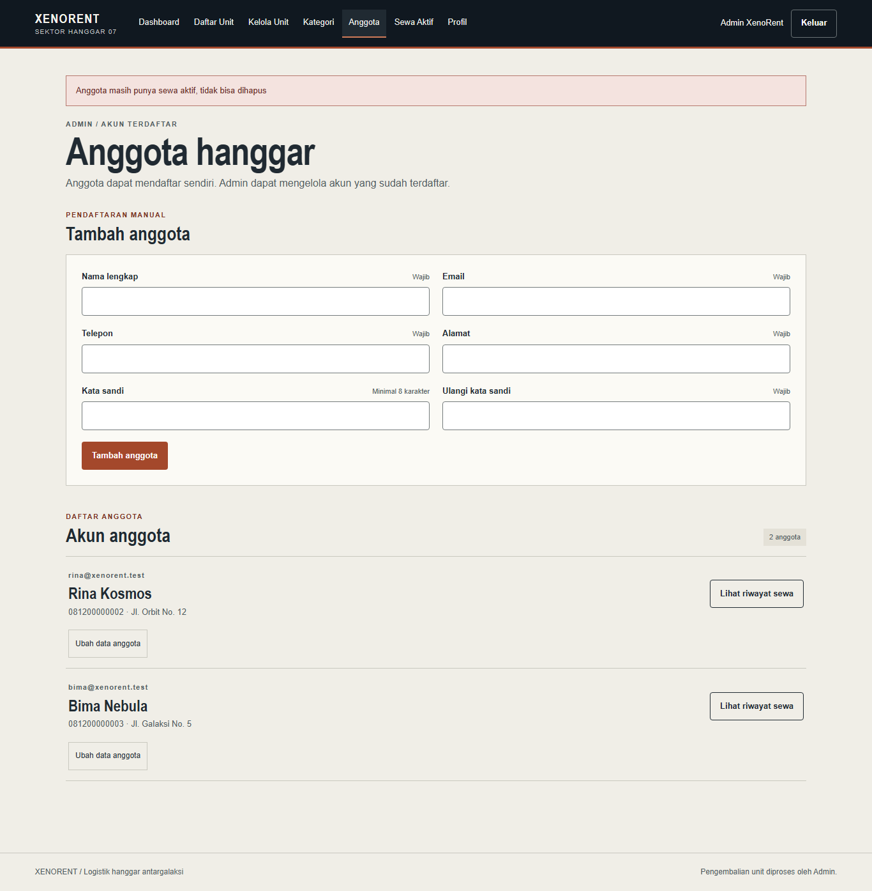

#### KP-22 — Anggota dengan 0 atau 1 sewa aktif menyewa unit tersedia

- **Fitur / referensi:** F-09 · BR-03, BR-12, BR-13, ATB-01, ATB-02, ATB-03, ATB-04
- **Hasil:** Lulus
- **Langkah:**
  1. Login sebagai Bima (0 sewa aktif).
  2. Buka Daftar Unit, cari "zeta", buka detail ZTS-002, tekan "Sewa kapal" dan setujui konfirmasi.
  3. Sewa satu unit lagi (NBS-002) saat sudah memegang 1 sewa aktif.
- **Hasil yang diharapkan:** Sewa tercatat, unit berubah disewa, jatuh tempo = hari ini + 5 hari; sewa kedua juga berhasil.

*Detail unit ZTS-002 berstatus tersedia dengan tombol Sewa kapal* — `KP-22_01_detail-unit-zts-002-berstatus-tersedia-dengan-tombol-sewa-kapal.png`

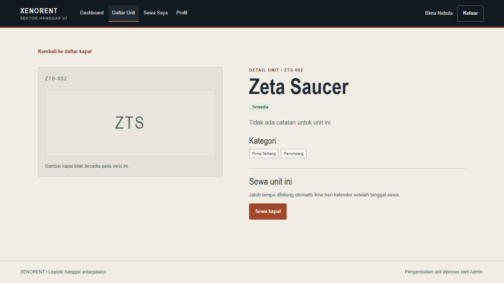

*Sewa berhasil: pesan sukses memuat tanggal jatuh tempo (hari ini + 5)* — `KP-22_02_sewa-berhasil-pesan-sukses-memuat-tanggal-jatuh-tempo-hari-ini-5.png`

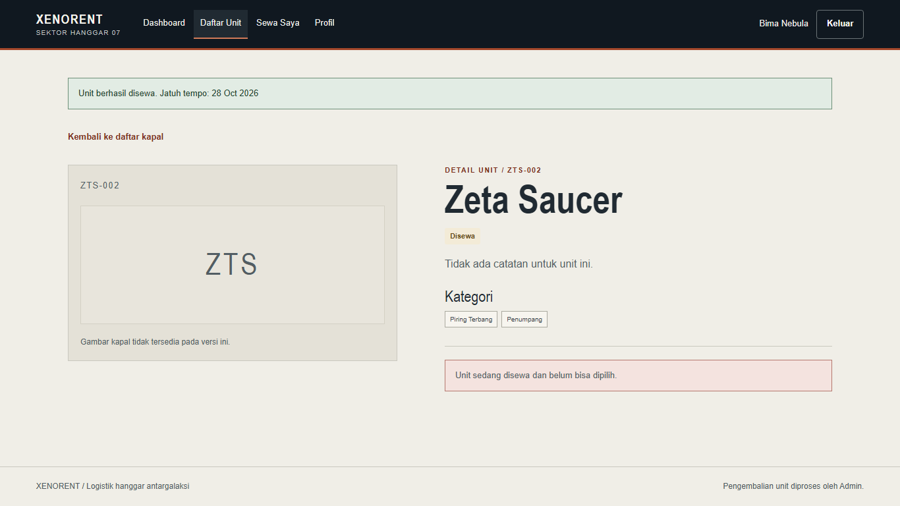

*Sewa Saya Bima: dua sewa aktif lengkap dengan jatuh tempo* — `KP-22_03_sewa-saya-bima-dua-sewa-aktif-lengkap-dengan-jatuh-tempo.png`

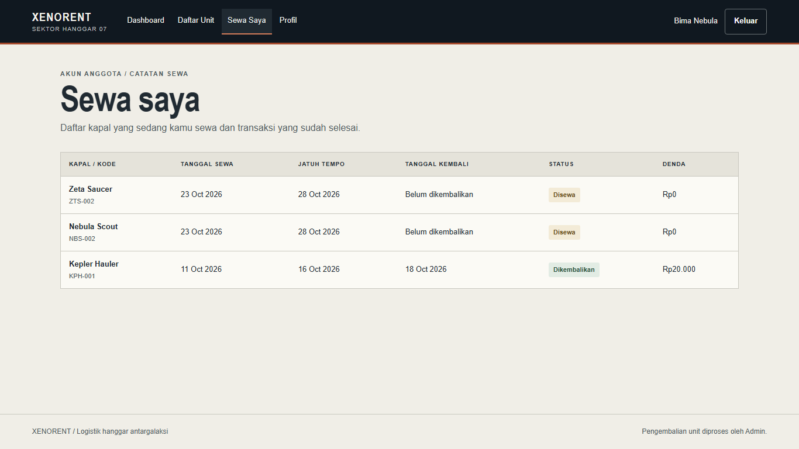

#### KP-23 — Anggota dengan 2 sewa aktif mencoba menyewa lagi

- **Fitur / referensi:** F-09 · BR-12, ATB-02, TB-02, NFR-02
- **Hasil:** Lulus
- **Langkah:**
  1. Login sebagai Rina (sudah memegang 2 unit aktif).
  2. Buka detail unit ZTS-002 yang tersedia lalu tekan "Sewa kapal".
- **Hasil yang diharapkan:** Ditolak dengan pesan "Kuota sewa penuh (maksimal 2 unit)"; sewa tidak bertambah dan unit tetap tersedia.

*Sewa ke-3 ditolak: kuota sewa penuh* — `KP-23_01_sewa-ke-3-ditolak-kuota-sewa-penuh.png`

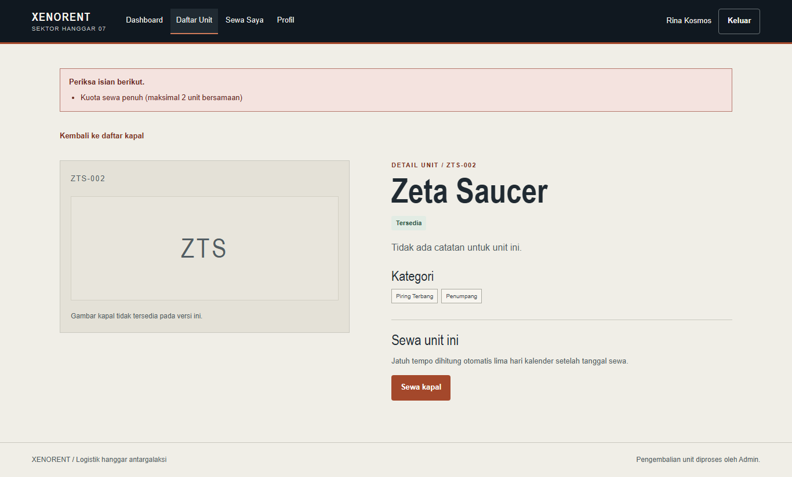

#### KP-24 — Anggota mencoba menyewa unit berstatus disewa

- **Fitur / referensi:** F-09 · ATB-03
- **Hasil:** Lulus
- **Langkah:**
  1. Login sebagai Bima.
  2. Buka detail ZTS-001 yang sedang disewa dan perhatikan tombol Sewa.
  3. Paksa penyewaan lewat permintaan langsung ke URL sewa unit tersebut.
- **Hasil yang diharapkan:** Tombol Sewa tidak aktif; jika dipaksa, ditolak dengan pesan "Unit sedang disewa" dan status sewa tidak berubah.

*Detail ZTS-001: tombol Sewa tidak tersedia, tertulis Unit sedang disewa* — `KP-24_01_detail-zts-001-tombol-sewa-tidak-tersedia-tertulis-unit-sedang-disewa.png`

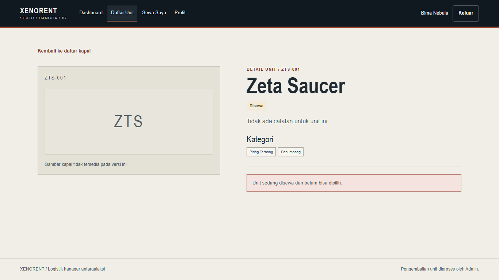

*Penyewaan dipaksa lewat URL ditolak server* — `KP-24_02_penyewaan-dipaksa-lewat-url-ditolak-server.png`

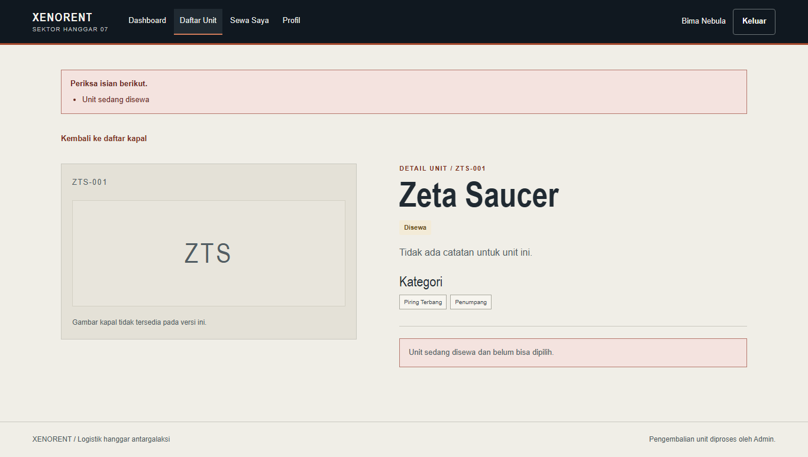

#### KP-25 — Admin membuka detail unit: tombol Sewa tidak tampil dan server menolak sewa dari Admin

- **Fitur / referensi:** F-09 · BR-03, PRD keputusan 2
- **Hasil:** Lulus
- **Langkah:**
  1. Login sebagai Admin lalu buka detail unit ZTS-002 yang tersedia.
  2. Paksa penyewaan lewat permintaan langsung ke URL sewa.
- **Hasil yang diharapkan:** Tombol Sewa tidak tampil untuk Admin; permintaan paksa ditolak (403) dan unit tetap tersedia.

*Detail unit tersedia dilihat Admin: tidak ada tombol Sewa* — `KP-25_01_detail-unit-tersedia-dilihat-admin-tidak-ada-tombol-sewa.png`

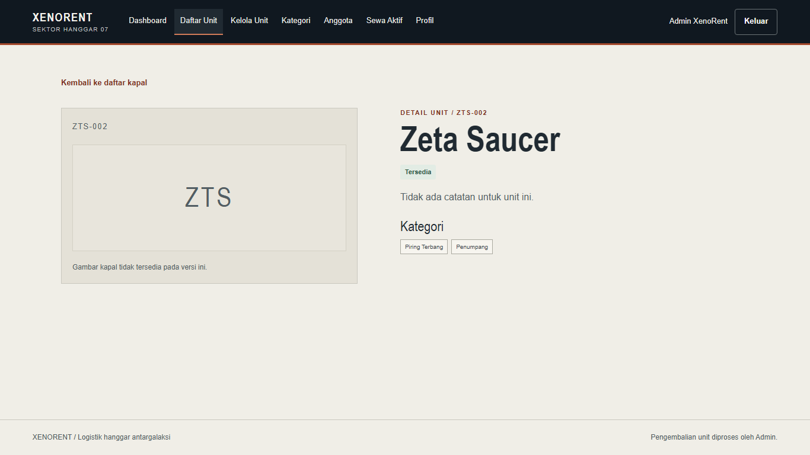

*Penyewaan dipaksa oleh Admin ditolak (403)* — `KP-25_02_penyewaan-dipaksa-oleh-admin-ditolak-403.png`

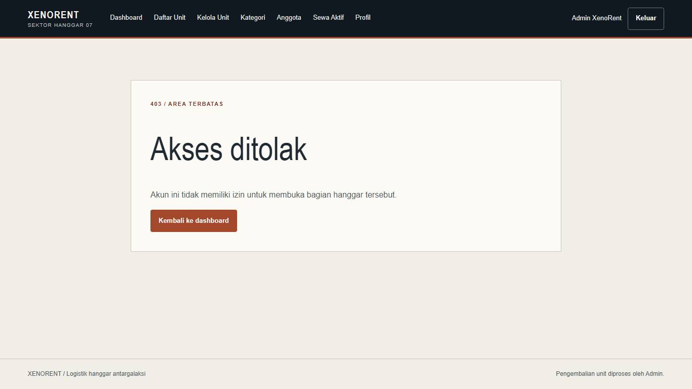

#### KP-26 — Sewa Saya hanya menampilkan sewa milik sendiri

- **Fitur / referensi:** F-10 · BR-16, TB-04
- **Hasil:** Lulus
- **Langkah:**
  1. Login sebagai Rina lalu buka Sewa Saya.
  2. Keluar, login sebagai Bima lalu buka Sewa Saya.
- **Hasil yang diharapkan:** Rina hanya melihat 2 sewa aktifnya; Bima hanya melihat sewa KPH-001 yang selesai beserta denda; keduanya memuat jatuh tempo.

*Sewa Saya Rina: hanya 2 sewa aktif miliknya* — `KP-26_01_sewa-saya-rina-hanya-2-sewa-aktif-miliknya.png`

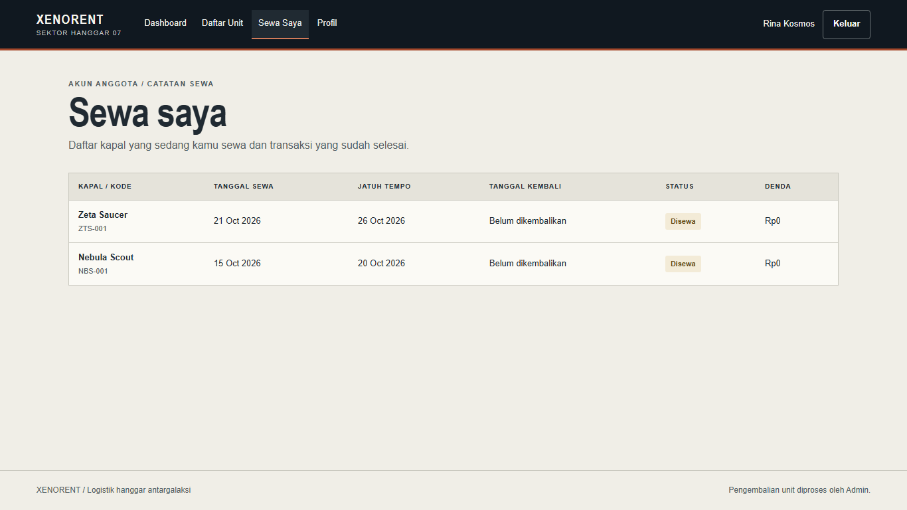

*Sewa Saya Bima: hanya sewa KPH-001 yang selesai beserta denda Rp20.000* — `KP-26_02_sewa-saya-bima-hanya-sewa-kph-001-yang-selesai-beserta-denda-rp20-000.png`

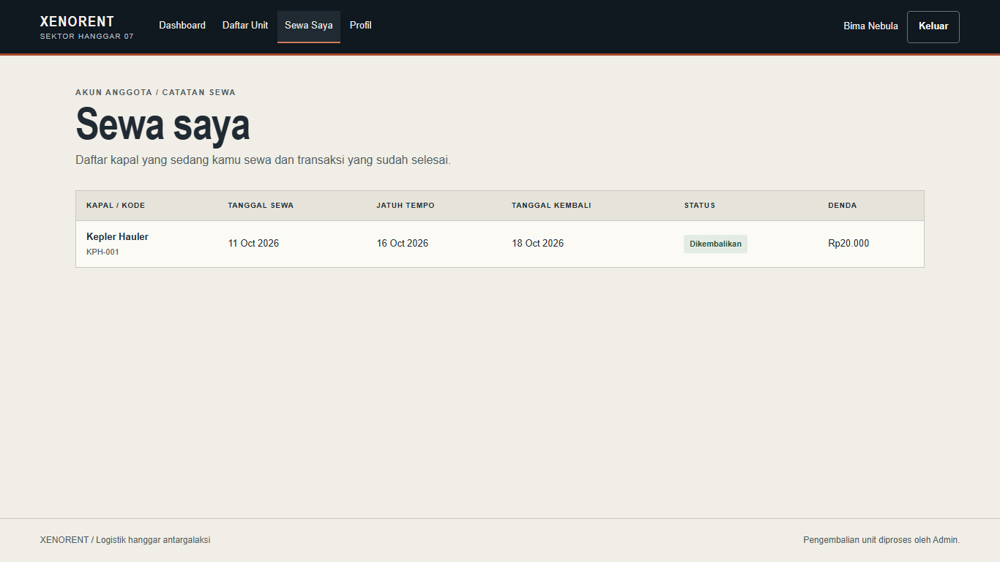

#### KP-27 — Admin membuka Sewa Aktif: semua sewa berstatus disewa dari semua anggota

- **Fitur / referensi:** F-11 · BR-15, C-02
- **Hasil:** Lulus
- **Langkah:**
  1. Login sebagai Bima dan sewa ZTS-002, lalu keluar.
  2. Login sebagai Admin lalu buka menu Sewa Aktif.
- **Hasil yang diharapkan:** Tampil seluruh sewa disewa dari Rina dan Bima (3 baris); sewa selesai tidak tampil; sewa lewat jatuh tempo bertanda Terlambat.

*Sewa Aktif Admin: 3 sewa dari 2 anggota, NBS-001 bertanda Terlambat* — `KP-27_01_sewa-aktif-admin-3-sewa-dari-2-anggota-nbs-001-bertanda-terlambat.png`

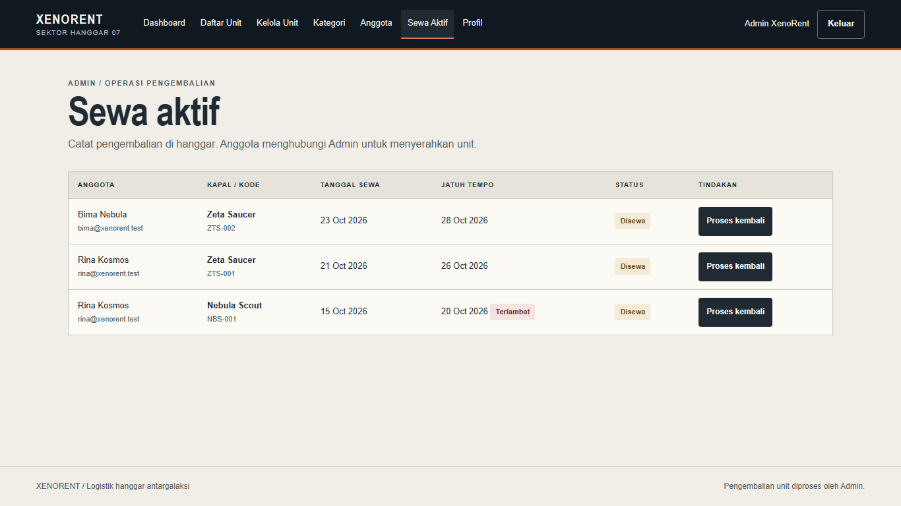

#### KP-28 — Admin memproses pengembalian sebelum atau tepat di jatuh tempo

- **Fitur / referensi:** F-12 · BR-14, ATB-02, ATB-04, ATB-05, ATB-06
- **Hasil:** Lulus
- **Langkah:**
  1. Login sebagai Admin lalu buka Sewa Aktif.
  2. Pada ZTS-001 milik Rina (jatuh tempo hari ini + 3) tekan "Proses kembali" dan setujui konfirmasi.
  3. Ulangi untuk sewa Bima yang jatuh temponya tepat hari ini.
  4. Login sebagai Rina dan periksa Sewa Saya serta sisa kuota.
- **Hasil yang diharapkan:** Status sewa dikembalikan, denda Rp0, unit kembali tersedia, dan kuota anggota pulih.

*Sewa Aktif sebelum pengembalian* — `KP-28_01_sewa-aktif-sebelum-pengembalian.png`

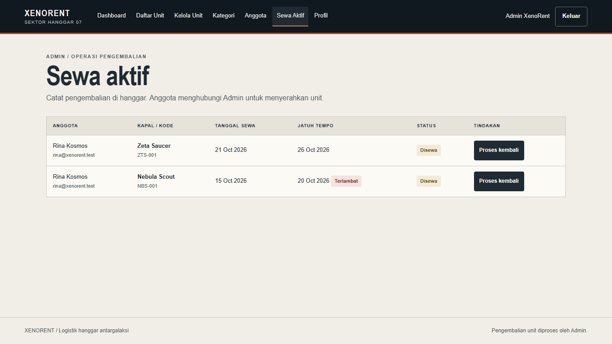

*Pengembalian sebelum jatuh tempo: Tidak ada denda* — `KP-28_02_pengembalian-sebelum-jatuh-tempo-tidak-ada-denda.png`

*Pengembalian tepat di hari jatuh tempo: Tidak ada denda* — `KP-28_03_pengembalian-tepat-di-hari-jatuh-tempo-tidak-ada-denda.png`

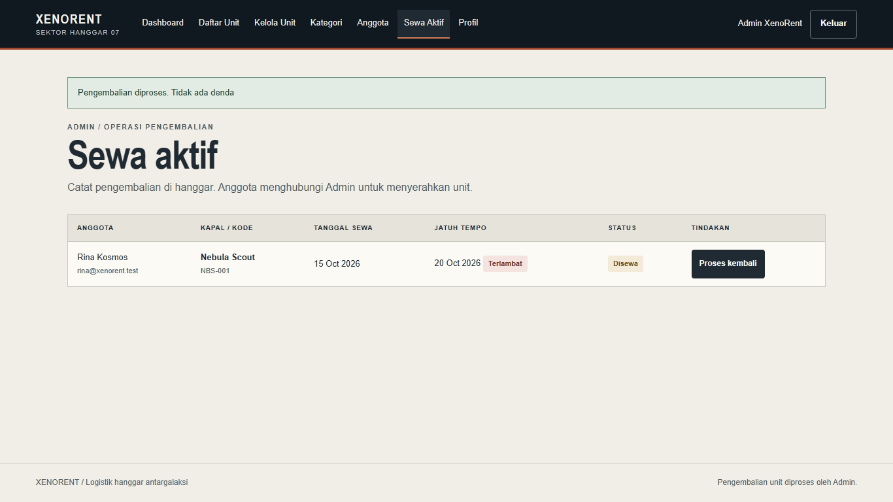

*Sewa Saya Rina: ZTS-001 dikembalikan, denda Rp0, kuota pulih menjadi 1 dari 2* — `KP-28_04_sewa-saya-rina-zts-001-dikembalikan-denda-rp0-kuota-pulih-menjadi-1-da.png`

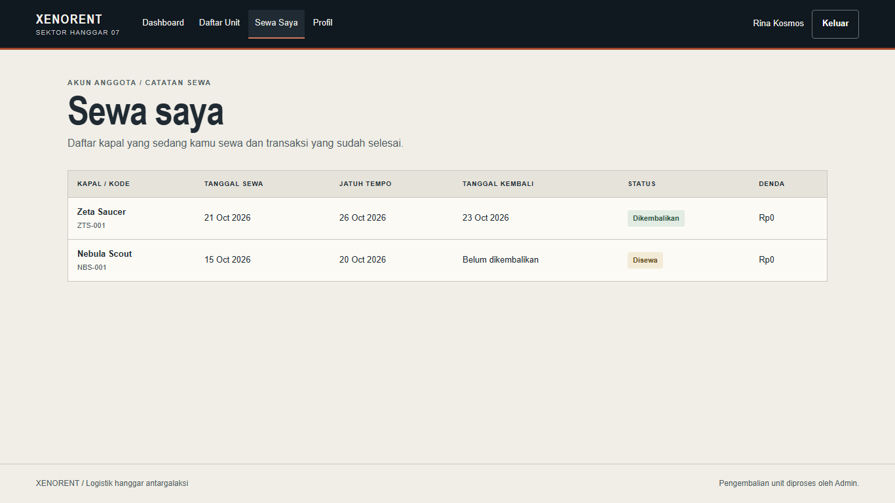

#### KP-29 — Admin memproses pengembalian 2 hari setelah jatuh tempo

- **Fitur / referensi:** F-12 · BR-13, ATB-05, TB-03, NFR-07
- **Hasil:** Lulus
- **Langkah:**
  1. Login sebagai Bima dan sewa ZTS-002; atur tanggal sewa menjadi 7 hari lalu sehingga jatuh tempo 2 hari lalu.
  2. Login sebagai Admin, buka Sewa Aktif, tekan "Proses kembali" pada sewa tersebut.
  3. Login sebagai Bima dan periksa Sewa Saya.
- **Hasil yang diharapkan:** Denda = 2 × tarif per hari (Rp20.000 dengan tarif Rp10.000); tercatat di sewa dan unit kembali tersedia.

*Sewa ZTS-002 Bima jatuh tempo 2 hari lalu, bertanda Terlambat* — `KP-29_01_sewa-zts-002-bima-jatuh-tempo-2-hari-lalu-bertanda-terlambat.png`

*Pengembalian diproses dengan denda Rp20.000 (2 hari × Rp10.000)* — `KP-29_02_pengembalian-diproses-dengan-denda-rp20-000-2-hari-rp10-000.png`

*Sewa Saya Bima menampilkan denda Rp20.000* — `KP-29_03_sewa-saya-bima-menampilkan-denda-rp20-000.png`

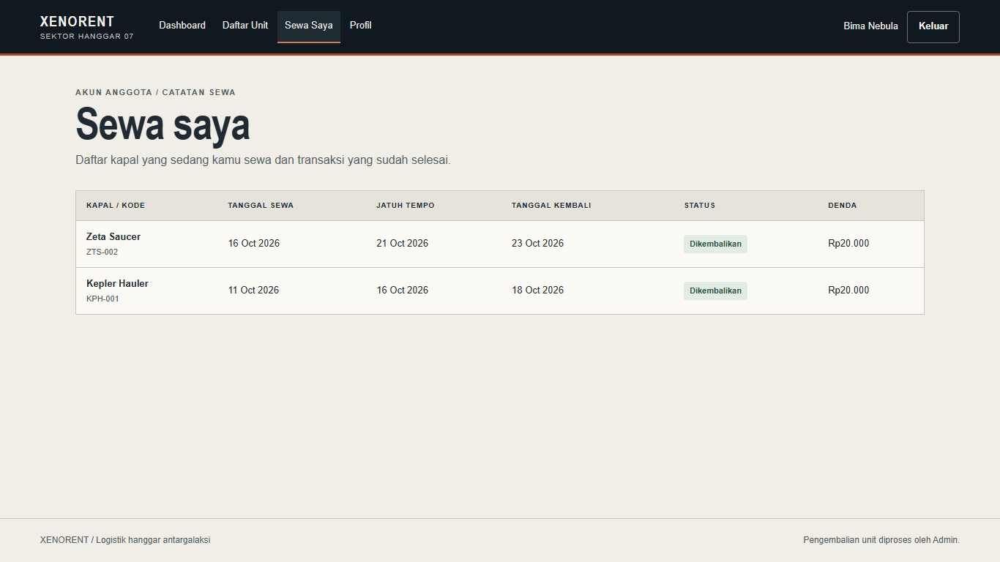

#### KP-30 — Admin memproses sewa yang sudah dikembalikan

- **Fitur / referensi:** F-12 · NFR-02, INT-06, Flowchart 3
- **Hasil:** Lulus
- **Langkah:**
  1. Login sebagai Admin dan buka Sewa Aktif di dua tab.
  2. Di tab pertama, proses pengembalian ZTS-001.
  3. Di tab kedua (tampilan lama), tekan "Proses kembali" pada sewa yang sama.
- **Hasil yang diharapkan:** Ditolak dengan pesan "Sewa sudah dikembalikan"; denda dan tanggal kembali tidak berubah dan tidak diproses dua kali.

*Tab kedua masih menampilkan ZTS-001 (data lama)* — `KP-30_01_tab-kedua-masih-menampilkan-zts-001-data-lama.png`

*Pemrosesan kedua ditolak* — `KP-30_02_pemrosesan-kedua-ditolak.png`

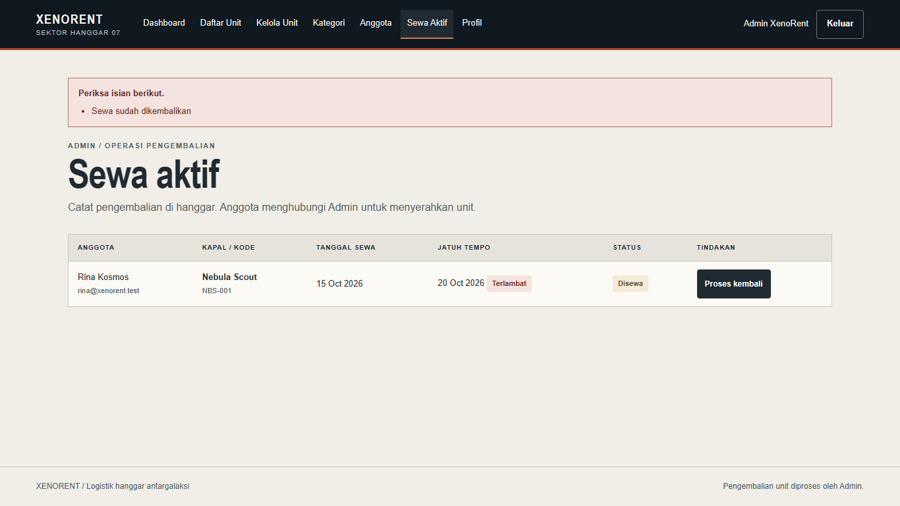

#### KP-31 — Anggota mencoba memproses pengembalian lewat URL

- **Fitur / referensi:** F-12 · BR-14, ATB-06, TB-04, NFR-01
- **Hasil:** Lulus
- **Langkah:**
  1. Login sebagai Rina (pemilik sewa ZTS-001).
  2. Paksa permintaan pengembalian ke URL proses kembali sewa tersebut.
- **Hasil yang diharapkan:** Ditolak dengan halaman "Akses ditolak" (403); sewa tetap berstatus disewa.

*Anggota memaksa proses kembali: halaman Akses ditolak (403)* — `KP-31_01_anggota-memaksa-proses-kembali-halaman-akses-ditolak-403.png`

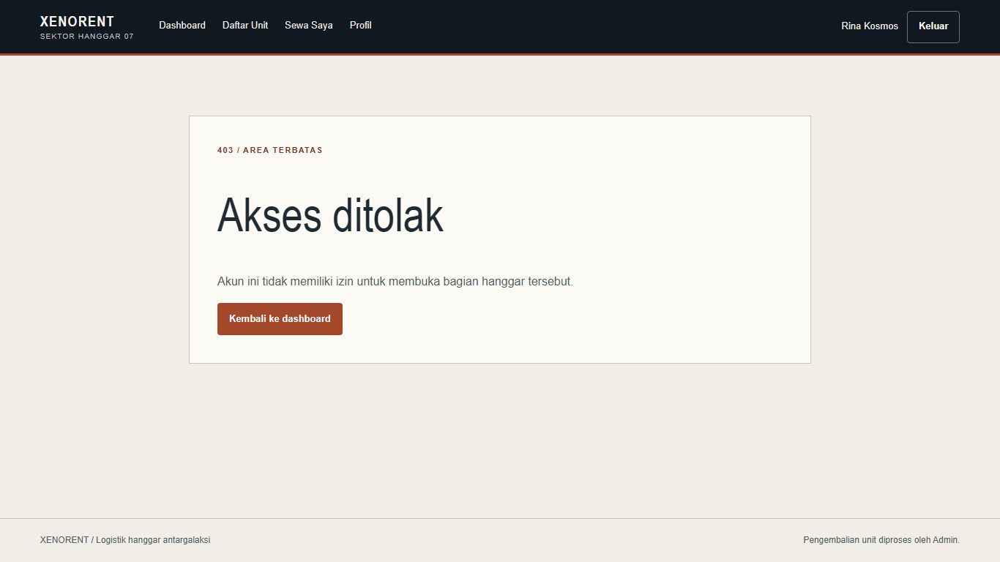

#### KP-32 — Admin membuka riwayat sewa dan mengubah tampilan mata uang denda

- **Fitur / referensi:** F-13 · BR-17, TB-05
- **Hasil:** Lulus
- **Langkah:**
  1. Login sebagai Admin lalu buka menu Anggota.
  2. Pada Bima tekan "Lihat riwayat sewa".
  3. Ubah tampilan denda ke USD lalu kembalikan ke Rupiah.
- **Hasil yang diharapkan:** Riwayat tampil lengkap dan nilai denda dihitung ulang sesuai kurs yang ditampilkan saat mata uang diubah.

*Riwayat sewa Bima: tanggal, status, denda IDR, dan konversi USD* — `KP-32_01_riwayat-sewa-bima-tanggal-status-denda-idr-dan-konversi-usd.png`

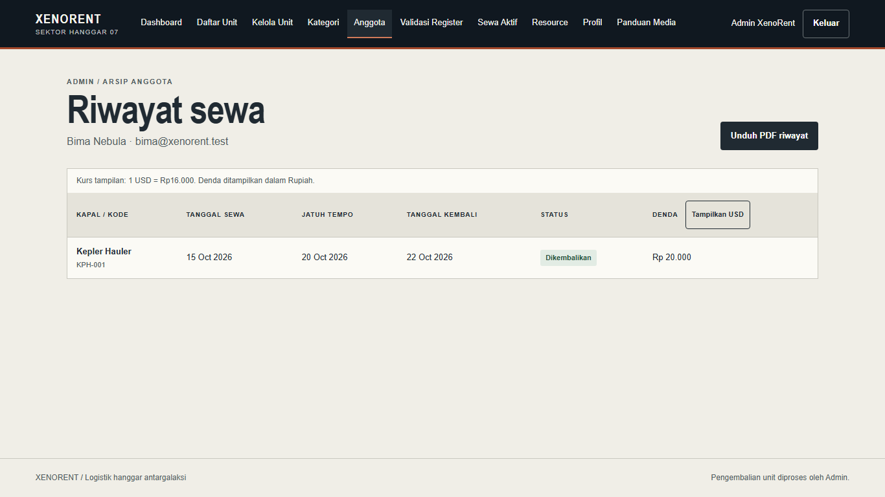

*Riwayat sewa Rina: dua sewa aktif* — `KP-32_02_riwayat-sewa-rina-dua-sewa-aktif.png`

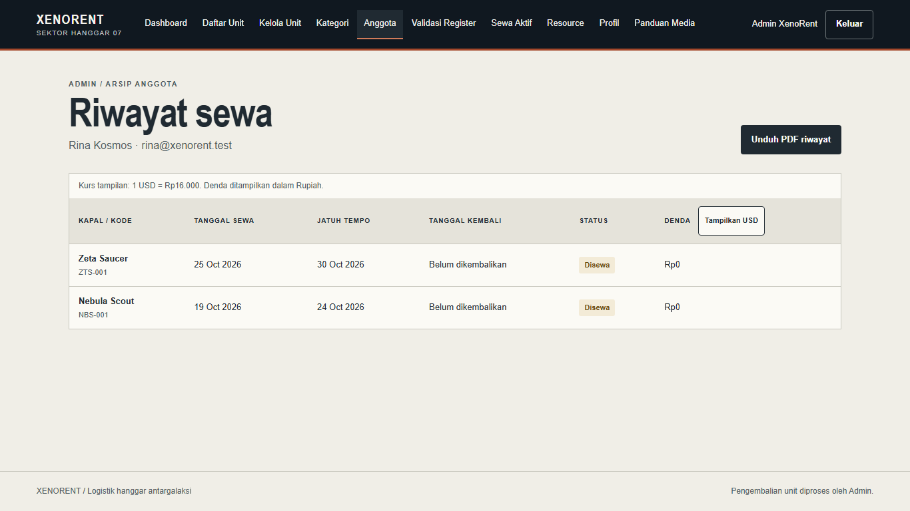

#### KP-33 — Admin menekan Cetak: tampilan cetak tanpa menu navigasi dan siap disimpan sebagai PDF

- **Fitur / referensi:** F-13 · BR-17, NFR-06
- **Hasil:** Lulus
- **Langkah:**
  1. Login sebagai Admin, buka riwayat sewa Bima, lalu tekan "Print riwayat".
  2. Di halaman versi cetak tekan "Print riwayat" (memanggil dialog cetak browser).
  3. Tampilkan halaman dalam mode cetak dan simpan sebagai PDF.
- **Hasil yang diharapkan:** Versi cetak tanpa menu navigasi, footer, dan tombol; tabel riwayat tampil rapi dan berhasil disimpan sebagai PDF.

*Halaman riwayat versi cetak di layar (sebelum mode cetak)* — `KP-33_01_halaman-riwayat-versi-cetak-di-layar-sebelum-mode-cetak.png`

*Tampilan mode cetak: tanpa menu navigasi, footer, dan tombol* — `KP-33_02_tampilan-mode-cetak-tanpa-menu-navigasi-footer-dan-tombol.png`

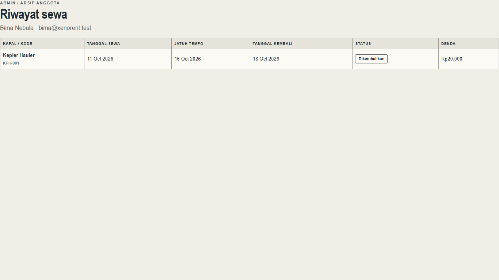

*PDF riwayat sewa berhasil dibuat* — `KP-33_03_pdf-riwayat-sewa-berhasil-dibuat.png`

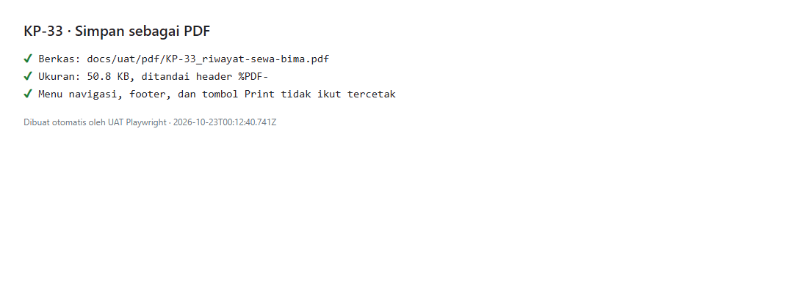

### B. Fitur pendukung (login, logout, profil, fitur Must lain)

#### F-02b — Logout mengakhiri sesi

- **Fitur / referensi:** F-02 · BR-01
- **Hasil:** Lulus
- **Langkah:**
  1. Login sebagai Rina lalu tekan "Keluar".
  2. Buka /dashboard.
- **Hasil yang diharapkan:** Pengguna kembali ke halaman login dan tidak bisa membuka /dashboard tanpa login ulang.

*Setelah menekan Keluar, pengguna di halaman login* — `F-02b_01_setelah-menekan-keluar-pengguna-di-halaman-login.png`

#### F-06b — Admin mengubah data unit dan kategorinya

- **Fitur / referensi:** F-06 · BR-09, BR-06
- **Hasil:** Lulus
- **Langkah:**
  1. Login sebagai Admin lalu buka Kelola Unit.
  2. Buka "Ubah data unit" pada ZTS-002, ganti nama dan kategorinya, lalu simpan.
- **Hasil yang diharapkan:** Perubahan tersimpan dan tampil di daftar.

*Form ubah unit ZTS-002 terisi perubahan* — `F-06b_01_form-ubah-unit-zts-002-terisi-perubahan.png`

*ZTS-002 setelah diubah* — `F-06b_02_zts-002-setelah-diubah.png`

#### F-06c — Admin menyimpan perubahan unit dengan kode milik unit lain

- **Fitur / referensi:** F-06 · BR-09, BR-18
- **Hasil:** Lulus
- **Langkah:**
  1. Login sebagai Admin lalu buka Kelola Unit.
  2. Ubah kode ZTS-002 menjadi ZTS-003 (milik unit lain) lalu simpan.
- **Hasil yang diharapkan:** Ditolak dengan pesan kode sudah dipakai; kode ZTS-002 tidak berubah.

*Perubahan kode ke ZTS-003 ditolak* — `F-06c_01_perubahan-kode-ke-zts-003-ditolak.png`

#### F-07b — Admin menambah dan mengubah kategori

- **Fitur / referensi:** F-07 · BR-10
- **Hasil:** Lulus
- **Langkah:**
  1. Login sebagai Admin lalu buka menu Kategori.
  2. Tambah kategori "Evakuasi" dengan deskripsi.
  3. Ubah namanya menjadi "Evakuasi Darurat" dan simpan.
- **Hasil yang diharapkan:** Kategori baru tampil dengan pesan sukses; perubahan nama tersimpan.

*Kategori Evakuasi berhasil ditambahkan* — `F-07b_01_kategori-evakuasi-berhasil-ditambahkan.png`

*Nama kategori berhasil diubah* — `F-07b_02_nama-kategori-berhasil-diubah.png`

#### F-08b — Admin menghapus anggota tanpa sewa aktif; riwayat sewanya tetap utuh

- **Fitur / referensi:** F-08 · BR-11, ATB-08, INT-08, TB-05
- **Hasil:** Lulus
- **Langkah:**
  1. Login sebagai Admin lalu buka menu Anggota.
  2. Pada Bima (tidak punya sewa aktif) buka "Ubah data anggota", tekan "Hapus akun", dan setujui konfirmasi.
  3. Buka riwayat sewa Bima lewat URL riwayat.
- **Hasil yang diharapkan:** Anggota hilang dari daftar; riwayat sewa Bima tetap bisa dibuka lengkap dengan dendanya.

*Bima terhapus dari daftar anggota* — `F-08b_01_bima-terhapus-dari-daftar-anggota.png`

*Riwayat sewa Bima tetap utuh setelah akunnya dihapus* — `F-08b_02_riwayat-sewa-bima-tetap-utuh-setelah-akunnya-dihapus.png`

#### F-16 — README memuat nama kelompok, nama tim, nama project, fitur, gambar skema database, dan video demo

- **Fitur / referensi:** F-16 · BR-21, TB-06
- **Hasil:** Lulus
- **Langkah:**
  1. Buka README.md di root repositori.
  2. Periksa keenam unsur wajib pada BR-21.
- **Hasil yang diharapkan:** README memuat nama kelompok, nama tim, nama project, daftar fitur, gambar skema database, dan tautan video demo.

*Pemeriksaan isi README.md* — `F-16_01_pemeriksaan-isi-readme-md.png`

### C. Fitur Should / Could

#### S-02 — Dialog konfirmasi sebelum menghapus

- **Fitur / referensi:** S-02 · BR-09 s.d. BR-11
- **Hasil:** Lulus
- **Langkah:**
  1. Login sebagai Admin dan buka "Ubah data unit" pada ZTS-002.
  2. Tekan "Hapus unit" lalu batalkan dialog konfirmasi.
  3. Tekan "Hapus unit" lagi dan setujui dialog.
- **Hasil yang diharapkan:** Dialog "Hapus unit ZTS-002?" muncul; saat dibatalkan unit tetap ada, saat disetujui unit terhapus.

*Dialog "Hapus unit ZTS-002?" dibatalkan: unit tetap ada* — `S-02_01_dialog-hapus-unit-zts-002-dibatalkan-unit-tetap-ada.png`

*Dialog disetujui: unit terhapus* — `S-02_02_dialog-disetujui-unit-terhapus.png`

*Teks dialog konfirmasi bawaan browser* — `S-02_03_teks-dialog-konfirmasi-bawaan-browser.png`

#### S-03 — Paginasi daftar

- **Fitur / referensi:** S-03 · PRD bagian 3
- **Hasil:** Lulus
- **Langkah:**
  1. Tambahkan 20 unit uji (kondisi uji) sehingga total 30 unit.
  2. Login sebagai Anggota dan buka Daftar Unit, lalu pindah ke halaman 2.
- **Hasil yang diharapkan:** Daftar dipecah per halaman (PRD: 10 baris per halaman) dengan navigasi halaman.

*Daftar unit halaman 1 dengan navigasi paginasi* — `S-03_01_daftar-unit-halaman-1-dengan-navigasi-paginasi.png`

*Daftar unit halaman 2* — `S-03_02_daftar-unit-halaman-2.png`

#### S-05 — Dashboard menampilkan sisa kuota (Anggota) dan angka ringkasan (Admin)

- **Fitur / referensi:** S-05, C-03 · PRD bagian 3
- **Hasil:** Lulus
- **Langkah:**
  1. Login sebagai Rina (2 sewa aktif) dan Bima (0 sewa aktif), lalu Admin.
- **Hasil yang diharapkan:** Rina melihat sisa kuota 0 dari 2; Bima 2 dari 2; Admin melihat unit tersedia 8, sewa aktif 2, anggota 2.

*Dashboard Rina: kuota penuh (0 dari 2)* — `S-05_01_dashboard-rina-kuota-penuh-0-dari-2.png`

*Dashboard Admin: angka ringkasan hanggar* — `S-05_02_dashboard-admin-angka-ringkasan-hanggar.png`

### D. Validasi field per form (F-14, NFR-03)

#### VAL-01 — Validasi form Registrasi

- **Fitur / referensi:** F-14, F-01 · PRD bagian 5 (Registrasi), NFR-03
- **Hasil:** Lulus
- **Langkah:**
  1. Buka /register dan tekan Daftar dengan semua field kosong (validasi browser aktif).
  2. Nonaktifkan validasi browser lalu kirim kosong agar validasi server yang teruji.
  3. Kirim data tidak valid: nama 101 karakter, email salah format, password 3 karakter, telepon non-angka.
  4. Kirim dengan konfirmasi password berbeda.
- **Hasil yang diharapkan:** Setiap field wajib ditolak dengan pesan Bahasa Indonesia berwarna merah di bawah field; isian lain tetap terisi; tidak ada akun baru.

*Form kosong ditahan oleh validasi bawaan browser* — `VAL-01_01_form-kosong-ditahan-oleh-validasi-bawaan-browser.png`

*Validasi server: semua field wajib menampilkan pesan di bawah field* — `VAL-01_02_validasi-server-semua-field-wajib-menampilkan-pesan-di-bawah-field.png`

*Data tidak valid: pesan per field, alamat tetap terisi* — `VAL-01_03_data-tidak-valid-pesan-per-field-alamat-tetap-terisi.png`

*Konfirmasi password berbeda ditolak, isian lain tetap terisi* — `VAL-01_04_konfirmasi-password-berbeda-ditolak-isian-lain-tetap-terisi.png`

#### VAL-02 — Validasi form Login

- **Fitur / referensi:** F-14, F-02 · PRD bagian 5 (Login)
- **Hasil:** Lulus
- **Langkah:**
  1. Buka /login dan kirim form kosong tanpa validasi browser.
  2. Kirim dengan email berformat salah.
- **Hasil yang diharapkan:** Email dan password wajib diisi; format email dicek; pesan tampil di bawah field.

*Login kosong: email dan password wajib diisi* — `VAL-02_01_login-kosong-email-dan-password-wajib-diisi.png`

*Email berformat salah ditolak* — `VAL-02_02_email-berformat-salah-ditolak.png`

#### VAL-03 — Validasi form Profil

- **Fitur / referensi:** F-14, F-03 · PRD bagian 5 (Profil)
- **Hasil:** Lulus
- **Langkah:**
  1. Login sebagai Rina dan buka Profil.
  2. Kosongkan semua field lalu simpan (tanpa validasi browser).
  3. Isi email milik Bima dan telepon non-angka lalu simpan.
- **Hasil yang diharapkan:** Field wajib ditolak, email yang dipakai akun lain ditolak, isian lain tetap terisi, dan profil Rina tidak berubah.

*Profil dikosongkan: semua field wajib menampilkan pesan* — `VAL-03_01_profil-dikosongkan-semua-field-wajib-menampilkan-pesan.png`

*Email milik akun lain dan telepon non-angka ditolak* — `VAL-03_02_email-milik-akun-lain-dan-telepon-non-angka-ditolak.png`

#### VAL-04 — Validasi form Unit

- **Fitur / referensi:** F-14, F-06 · PRD bagian 5 (Unit)
- **Hasil:** Lulus
- **Langkah:**
  1. Login sebagai Admin dan buka Kelola Unit.
  2. Kirim form tambah unit kosong (tanpa validasi browser).
  3. Kirim kode berisi spasi/simbol, kode 21 karakter, dan deskripsi 1001 karakter.
- **Hasil yang diharapkan:** Kode, nama, dan kategori wajib; kode hanya huruf/angka/tanda hubung/garis bawah dan maksimal 20; deskripsi maksimal 1000; tidak ada unit tersimpan.

*Form unit kosong: kode, nama, dan kategori wajib* — `VAL-04_01_form-unit-kosong-kode-nama-dan-kategori-wajib.png`

*Kode berisi simbol dan deskripsi terlalu panjang ditolak* — `VAL-04_02_kode-berisi-simbol-dan-deskripsi-terlalu-panjang-ditolak.png`

*Kode 21 karakter ditolak* — `VAL-04_03_kode-21-karakter-ditolak.png`

#### VAL-05 — Validasi form Kategori

- **Fitur / referensi:** F-14, F-07 · PRD bagian 5 (Kategori)
- **Hasil:** Lulus
- **Langkah:**
  1. Login sebagai Admin dan buka Kategori.
  2. Kirim form kosong, lalu nama 51 karakter dan deskripsi 501 karakter.
- **Hasil yang diharapkan:** Nama wajib, maksimal 50 karakter; deskripsi maksimal 500 karakter; tidak ada kategori tersimpan.

*Form kategori kosong: nama wajib diisi* — `VAL-05_01_form-kategori-kosong-nama-wajib-diisi.png`

*Nama 51 karakter dan deskripsi 501 karakter ditolak* — `VAL-05_02_nama-51-karakter-dan-deskripsi-501-karakter-ditolak.png`

#### VAL-06 — Validasi form Anggota (Admin)

- **Fitur / referensi:** F-14, F-08 · PRD bagian 5 (Anggota Admin), NFR-03
- **Hasil:** Lulus
- **Langkah:**
  1. Login sebagai Admin dan buka Anggota.
  2. Kirim form tambah anggota kosong (tanpa validasi browser).
  3. Isi sebagian data dengan password 7 karakter dan email milik anggota lain, lalu kirim.
  4. Ubah email Bima menjadi email Rina dan simpan.
- **Hasil yang diharapkan:** Semua field wajib ditolak dengan pesan merah; password minimal 8; email unik; isian lain tidak hilang saat gagal simpan; tidak ada anggota baru.

*Form anggota kosong: seluruh field wajib ditolak* — `VAL-06_01_form-anggota-kosong-seluruh-field-wajib-ditolak.png`

*Email dipakai akun lain dan password 7 karakter ditolak* — `VAL-06_02_email-dipakai-akun-lain-dan-password-7-karakter-ditolak.png`

#### VAL-06b — Validasi ubah anggota: email milik anggota lain ditolak

- **Fitur / referensi:** F-14, F-08 · KP-20, PRD bagian 5 (Anggota Admin)
- **Hasil:** Lulus
- **Langkah:**
  1. Login sebagai Admin dan buka Anggota.
  2. Pada Bima, ubah email menjadi email Rina lalu simpan.
- **Hasil yang diharapkan:** Ditolak dengan pesan "Email sudah terdaftar"; email Bima tidak berubah.

*Email milik Rina ditolak saat mengubah Bima* — `VAL-06b_01_email-milik-rina-ditolak-saat-mengubah-bima.png`

#### VAL-07 — Validasi kata kunci pencarian maksimal 100 karakter

- **Fitur / referensi:** F-14, F-05 · PRD bagian 5 (Pencarian)
- **Hasil:** Lulus
- **Langkah:**
  1. Login sebagai Anggota.
  2. Buka /units?q= dengan kata kunci 101 karakter (melewati batas input di browser).
- **Hasil yang diharapkan:** Server menolak dengan pesan "Kata kunci maksimal 100 karakter".

*Pencarian dengan 101 karakter* — `VAL-07_01_pencarian-dengan-101-karakter.png`

### E. Kondisi tampilan (PRD bagian 8)

#### KT-01 — Sewa Saya kosong untuk anggota yang belum pernah menyewa

- **Fitur / referensi:** F-10 · PRD bagian 8 (kondisi kosong)
- **Hasil:** Lulus
- **Langkah:**
  1. Daftar sebagai anggota baru.
  2. Buka Sewa Saya dan Dashboard.
- **Hasil yang diharapkan:** Tampil "Kamu belum pernah menyewa unit." dengan tautan ke Daftar Unit.

*Dashboard anggota baru: belum ada sewa* — `KT-01_01_dashboard-anggota-baru-belum-ada-sewa.png`

*Sewa Saya kosong dengan tautan ke Daftar Unit* — `KT-01_02_sewa-saya-kosong-dengan-tautan-ke-daftar-unit.png`

#### KT-02 — Sewa Aktif kosong setelah semua unit dikembalikan

- **Fitur / referensi:** F-11 · PRD bagian 8 (kondisi kosong)
- **Hasil:** Lulus
- **Langkah:**
  1. Login sebagai Admin dan proses pengembalian seluruh sewa aktif (ZTS-001 dan NBS-001).
  2. Buka Sewa Aktif dan Dashboard Admin.
- **Hasil yang diharapkan:** Tampil "Tidak ada unit yang sedang disewa."

*Sewa Aktif kosong setelah semua dikembalikan* — `KT-02_01_sewa-aktif-kosong-setelah-semua-dikembalikan.png`

#### KT-03 — Riwayat anggota kosong: tombol Cetak nonaktif

- **Fitur / referensi:** F-13 · PRD bagian 8 (kondisi kosong)
- **Hasil:** Lulus
- **Langkah:**
  1. Daftar anggota baru lalu keluar.
  2. Login sebagai Admin dan buka riwayat sewa anggota baru tersebut.
- **Hasil yang diharapkan:** Tampil "Anggota ini belum pernah menyewa."; tombol Cetak nonaktif.

*Riwayat anggota baru kosong dengan tombol cetak nonaktif* — `KT-03_01_riwayat-anggota-baru-kosong-dengan-tombol-cetak-nonaktif.png`

#### KT-04 — Daftar unit kosong

- **Fitur / referensi:** F-04 · PRD bagian 8 (kondisi kosong)
- **Hasil:** Lulus
- **Langkah:**
  1. Kosongkan seluruh unit (kondisi uji).
  2. Login sebagai Anggota lalu sebagai Admin dan buka Daftar Unit.
- **Hasil yang diharapkan:** Tampil "Belum ada unit."; Admin melihat tombol/tautan untuk menambah unit.

*Daftar unit kosong untuk Anggota* — `KT-04_01_daftar-unit-kosong-untuk-anggota.png`

*Daftar unit kosong untuk Admin* — `KT-04_02_daftar-unit-kosong-untuk-admin.png`

#### KT-05 — Halaman 404 untuk data yang tidak ada

- **Fitur / referensi:** PRD halaman 14 · PRD bagian 8 (error tidak ditemukan)
- **Hasil:** Lulus
- **Langkah:**
  1. Login sebagai Anggota lalu buka /units/99999.
  2. Login sebagai Admin lalu buka riwayat anggota dengan ID yang tidak ada.
- **Hasil yang diharapkan:** Tampil halaman 404 "Data tidak ditemukan" dengan tautan kembali.

*Detail unit yang tidak ada: halaman 404* — `KT-05_01_detail-unit-yang-tidak-ada-halaman-404.png`

*Riwayat anggota yang tidak ada: halaman 404* — `KT-05_02_riwayat-anggota-yang-tidak-ada-halaman-404.png`

#### KT-06 — Tombol kirim nonaktif dan berlabel "Memproses..." sehingga klik ganda tidak membuat sewa ganda

- **Fitur / referensi:** S-01 · PRD bagian 8 (proses), NFR-02
- **Hasil:** Lulus
- **Langkah:**
  1. Login sebagai Bima dan buka detail unit ZTS-002.
  2. Perlambat respons server, lalu klik ganda "Sewa kapal".
  3. Periksa label tombol dan jumlah sewa yang tercatat.
- **Hasil yang diharapkan:** Tombol berubah menjadi "Memproses..." dan nonaktif; hanya satu sewa yang tercatat.

*Tombol berlabel Memproses... dan nonaktif setelah ditekan* — `KT-06_01_tombol-berlabel-memproses-dan-nonaktif-setelah-ditekan.png`

*Setelah respons datang: satu sewa tercatat* — `KT-06_02_setelah-respons-datang-satu-sewa-tercatat.png`

### F. Tujuan bisnis (BRD bagian 3)

#### TB-03 — Denda sistem sama dengan hitungan manual di semua skenario keterlambatan

- **Fitur / referensi:** F-12 · TB-03, PRD kriteria sukses 4
- **Hasil:** Lulus
- **Langkah:**
  1. Proses pengembalian NBS-001 dari data seed (jatuh tempo 3 hari lalu).
  2. Buat sewa Bima yang terlambat 1 hari dan 5 hari lalu proses pengembaliannya.
  3. Bandingkan denda di layar dengan hitungan manual: hari terlambat × Rp10.000.
- **Hasil yang diharapkan:** Denda 3 hari = Rp30.000 (NBS-001 seed), 1 hari = Rp10.000, 5 hari = Rp50.000.

*NBS-001 seed (terlambat 3 hari): Denda Rp30.000* — `TB-03_01_nbs-001-seed-terlambat-3-hari-denda-rp30-000.png`

*Terlambat 1 hari: Denda Rp10.000* — `TB-03_02_terlambat-1-hari-denda-rp10-000.png`

*Terlambat 5 hari: Denda Rp50.000* — `TB-03_03_terlambat-5-hari-denda-rp50-000.png`

*Rekap hitungan manual vs sistem* — `TB-03_04_rekap-hitungan-manual-vs-sistem.png`

### G. Kebutuhan non-fungsional (BRD bagian 6)

#### NFR-01 — Password disimpan sebagai hash; halaman dilindungi login dan peran di server

- **Fitur / referensi:** NFR-01 · BR-01, TB-04
- **Hasil:** Lulus
- **Langkah:**
  1. Periksa kolom password semua akun di tabel users.
  2. Lihat hasil KP-05, KP-06, dan KP-31 untuk akses per peran.
- **Hasil yang diharapkan:** Tidak ada password teks biasa; semua berupa hash bcrypt.

*Password tersimpan sebagai hash* — `NFR-01_01_password-tersimpan-sebagai-hash.png`

#### NFR-02 — Permintaan sewa beruntun tidak bisa melewati kuota 2 unit

- **Fitur / referensi:** NFR-02 · TB-02, INT-04, INT-05
- **Hasil:** Lulus
- **Langkah:**
  1. Login sebagai Bima (0 sewa aktif).
  2. Kirim 4 permintaan sewa ke 4 unit tersedia sekaligus.
  3. Periksa jumlah sewa aktif Bima.
- **Hasil yang diharapkan:** Tepat 2 sewa berhasil; sisanya ditolak; tidak pernah lebih dari 2 sewa aktif.

*Setelah 4 permintaan sewa beruntun: kuota Bima tepat penuh (2 unit)* — `NFR-02_01_setelah-4-permintaan-sewa-beruntun-kuota-bima-tepat-penuh-2-unit.png`

*Rekap permintaan sewa beruntun* — `NFR-02_02_rekap-permintaan-sewa-beruntun.png`

#### NFR-04 — Tampilan dapat dipakai di layar HP (lebar 390 px) tanpa scroll horizontal halaman

- **Fitur / referensi:** NFR-04, S-04 · PRD bagian 3
- **Hasil:** Lulus
- **Langkah:**
  1. Atur lebar layar 390 × 844 px.
  2. Buka Login, Dashboard, Daftar Unit, Detail Unit, Sewa Saya sebagai Anggota, lalu Kelola Unit dan Sewa Aktif sebagai Admin.
- **Hasil yang diharapkan:** Setiap halaman tampil utuh tanpa melebar melewati layar.

*HP: Login* — `NFR-04_01_hp-login.png`

*HP: Dashboard Anggota* — `NFR-04_02_hp-dashboard-anggota.png`

*HP: Daftar Unit* — `NFR-04_03_hp-daftar-unit.png`

*HP: Detail Unit* — `NFR-04_04_hp-detail-unit.png`

*HP: Sewa Saya* — `NFR-04_05_hp-sewa-saya.png`

*HP: Kelola Unit (Admin)* — `NFR-04_06_hp-kelola-unit-admin.png`

*HP: Sewa Aktif (Admin)* — `NFR-04_07_hp-sewa-aktif-admin.png`

#### NFR-07 — Tarif denda dan durasi sewa dibaca dari konfigurasi, bukan ditulis di kode

- **Fitur / referensi:** NFR-07 · INT-09, BR-13
- **Hasil:** Lulus
- **Langkah:**
  1. Baca nilai tarif dan durasi dari aplikasi tanpa pengaturan khusus.
  2. Ubah hanya variabel environment RENTAL_DAILY_FINE dan RENTAL_DURATION_DAYS, lalu baca ulang.
- **Hasil yang diharapkan:** Nilai bawaan 10000 dan 5; setelah env diubah menjadi 15000 dan 7, aplikasi memakai nilai baru tanpa mengubah kode.

*Tarif dan durasi dari konfigurasi* — `NFR-07_01_tarif-dan-durasi-dari-konfigurasi.png`

#### NFR-08 — migrate:fresh --seed membangun ulang database dengan data seed sesuai PRD

- **Fitur / referensi:** NFR-08, F-15 · BR-19, BR-20, PRD bagian 9
- **Hasil:** Lulus
- **Langkah:**
  1. Jalankan php artisan migrate:fresh --seed.
  2. Periksa jumlah dan isi data: 3 akun, 6 kategori, 10 unit, 3 sewa contoh dengan tanggal relatif.
- **Hasil yang diharapkan:** Perintah selesai tanpa error dan data seed sama dengan tabel di PRD bagian 9.

*Hasil migrate:fresh --seed* — `NFR-08_01_hasil-migrate-fresh-seed.png`

### H. Integritas data (Flowchart & ERD bagian 9)

#### INT-01 — Kode unit dan email unik di level database, termasuk bekas data terhapus

- **Fitur / referensi:** INT-01 · ATB-07, ATB-11, TB-01
- **Hasil:** Lulus
- **Langkah:**
  1. Coba menyisipkan langsung ke database kode unit ganda dan email ganda.
  2. Login sebagai Admin, hapus unit ZTS-002, lalu tambah unit baru berkode ZTS-002.
- **Hasil yang diharapkan:** Database menolak duplikat (UNIQUE); kode bekas unit terhapus juga tidak bisa dipakai ulang.

*Kode ZTS-002 milik unit yang sudah dihapus tetap tidak bisa dipakai ulang* — `INT-01_01_kode-zts-002-milik-unit-yang-sudah-dihapus-tetap-tidak-bisa-dipakai-ul.png`

*Penolakan duplikat oleh database* — `INT-01_02_penolakan-duplikat-oleh-database.png`

#### INT-02 — Satu akun satu profil dan pasangan unit-kategori tidak ganda

- **Fitur / referensi:** INT-02, INT-03 · BR-04, BR-06
- **Hasil:** Lulus
- **Langkah:**
  1. Coba menyisipkan profil kedua untuk akun yang sama.
  2. Coba menyisipkan pasangan unit-kategori yang sudah ada.
- **Hasil yang diharapkan:** Database menolak keduanya dengan error UNIQUE.

*Penolakan duplikat oleh database* — `INT-02_01_penolakan-duplikat-oleh-database.png`

#### INT-03 — Foreign key rentals bersifat restrict: akun/unit dengan sewa tidak bisa dihapus permanen

- **Fitur / referensi:** INT-07, INT-08 · ATB-08, TB-05
- **Hasil:** Lulus
- **Langkah:**
  1. Coba menghapus permanen akun Rina dan unit ZTS-001 yang punya sewa langsung dari database.
- **Hasil yang diharapkan:** Database menolak dengan FOREIGN KEY constraint failed sehingga riwayat sewa tidak bisa yatim.

*Penghapusan permanen ditolak database* — `INT-03_01_penghapusan-permanen-ditolak-database.png`

